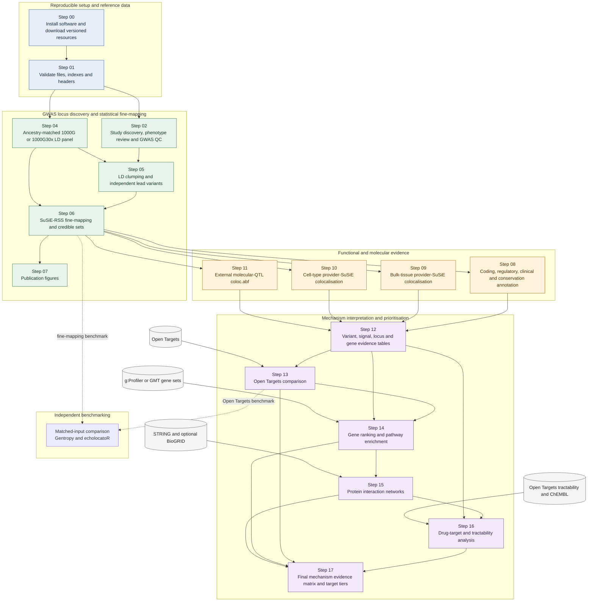

# GWAS2Mech

From GWAS summary statistics to candidate molecular mechanisms: discover and quality-control GWAS,
build ancestry-matched LD panels, identify and fine-map loci with SuSiE-RSS, annotate credible-set
variants, colocalise signals with molecular QTLs, and integrate the evidence into genes, pathways,
networks and therapeutic hypotheses.

Everything is installed and downloaded **inside the directory you run the scripts from**,
so the same commands work on a laptop, a workstation or any SLURM cluster.
Run every command from the repository directory.

## Pipeline at a glance



Arrows represent data dependencies. Steps 09–11 provide distinct molecular-QTL evidence channels;
Step 12 preserves their provenance while joining them to fine-mapping and functional annotation.

| Step | Script | What it does | One SLURM job per | Output |
|---|---|---|---|---|
| 0 | `Step00_Installation.py` | installs all software into `envs/` | – | `envs/`, `external_tools/` |
| 0 | `Step00_Download_Resources.py` | downloads the shared reference data | file | `resources/` |
| 1 | `Step01_Download_Resources_Checkheaders.py` | checks every download is readable | – | `setup_manifests/` |
| 2 | `Step02_Plan_QC_GWAS.py` | finds the GWAS, classifies Binary / Continuous, **downloads and QCs each GWAS in one job** | GWAS | `01_gwas_catalog/`, `02_summary_stats/` |
| 4 | `Step04_Prepare_LD_Reference.py` | ancestry-specific 1000G or 1000G30x LD panels | chromosome | `resources/1000G/<ANC>/` or `resources/LD_panels/1000G30x/<ANC>/` |
| 5 | `Step05_Clump_GWAS_Loci.py` | LD clumping → independent lead variants | GWAS | `05_ld_clumping/` |
| 6 | `Step06_FineMap_GWAS_Loci.py` | SuSiE-RSS fine-mapping with locus QC | GWAS | `06_finemapping/` |
| 7 | `Step07_Plots.py` | Manhattan, ideograms, regional / LD / PIP / gene figures | – (one job) | `07_plots/` |
| 8 | `Step08_Annotate_Finemapped_Variants.py` | local VEP, CADD, AlphaMissense, ClinVar, cCRE, phyloP, LOEUF, RegulomeDB | GWAS | `08_annotation/` |
| 9 | `Step09_Colocalize_GTEx_SuSiE.py` | provider-SuSiE coloc (coloc.bf_bf) with bulk-tissue eQTL / sQTL / isoQTL / exonQTL / pQTL | **locus** | `09_coloc/` |
| 10 | `Step10_CellType_QTL_Colocalization.py` | the same with single-cell / cell-type eQTL | **locus** | `10_celltype_coloc/` |
| 11 | `Step11_Custom_QTL_Colocalization.py` | coloc.abf with the downloaded molecular QTL (ADSP FunGen brain sQTL / pQTL / haQTL / mQTL, Kumasaka caQTL), every Step06 locus | **locus** | `11_custom_qtl_coloc/` |
| 12 | `Step12_Master_Table.py` | variant → signal → gene → tissue / cell master tables (Steps 06, 08, 09, 10, 11) | – (one job) | `12_master_table/` |
| 13 | `Step13_Compare_OpenTargets.py` | loci / genes / mechanisms vs Open Targets credible sets, L2G, colocalisation | – (one job) | `13_opentargets_comparison/` |
| 14 | `Step14_Pathway_Analysis.py` | one-vote-per-gene ranking, gene sets, pathway enrichment (g:Profiler or GMT) | – (one job) | `14_pathways/` |
| 15 | `Step15_PPI_Network_Analysis.py` | STRING (optional BioGRID) networks, centrality, connectors | – (one job) | `15_network/` |
| 16 | `Step16_Drug_Target_Analysis.py` | tractability (Open Targets), drugs / mechanisms (ChEMBL), direction of effect | – (one job) | `16_drug_targets/` |
| 17 | `Step17_Final_Mechanism_Integration.py` | final evidence matrix, tiers and target ranking | – (one job) | `17_mechanism/` |

Every step plans its own SLURM array from the `#SBATCH` header of `HPC_CPU.sh` (never more than
1,000 jobs; above that, a job processes several items), skips work that is already done, and
has `--status` (progress) and `--stats` (results). `--index N` runs study N on the current machine
(see the quick start).

## Quick start: one Parkinson's disease GWAS, end to end

`--index N` runs **one study** through a step on the current machine. N is the study number the
Step02 planner prints, and it is the **same N in Steps 02, 05, 06, 07, 08 and 09**; only that
study has to be through the previous step. In Step04, `--index N` builds LD panel chromosome N.
Each command skips work that is already finished, so it can be re-run safely.

Heavy steps should run on a compute node, not the login node. Set `RUN` once with your
cluster's values (the ones in `HPC_CPU.sh`):

```bash
RUN="srun --account=a_ace --partition=general --qos=normal --cpus-per-task=8 --mem=64G --time=12:00:00"
PD=(--phenotype "Parkinson's disease" --ancestry EUR)

# 0. once per installation: software, then the reference data (1000 Genomes, GRCh38 + GENCODE,
#    VEP cache, variant annotation, CADD, eQTL Catalogue lists + brain QTLs)
python Step00_Installation.py
envs/pipeline/bin/python Step00_Download_Resources.py --groups gwas_catalog 1000g genome vep annotation cadd eqtl_catalogue --output Step00_Download_QuickStart.sh
# Step09 QTLs: eQTL Catalogue GTEx brain tissues, dense + provider SuSiE (LBF files are sorted + indexed)
#   (Step09 tests the contexts that are downloaded; TISSUE_REGEX = r"brain" in Step09_Config.py lists only these;
#    all GTEx + Sun_2018 pQTL: omit --catalogue-tissue-regex)
envs/pipeline/bin/python Step00_Download_Resources.py --groups qtl_catalogue qtl_catalogue_susie --catalogue-tissue-regex brain --output Step00_Download_QTL.sh
sbatch Step00_Download_QTL.sh
sbatch Step00_Download_QuickStart.sh
envs/pipeline/bin/python Step00_Download_Resources.py --status   # wait until every group is complete

# 1. find the Parkinson's GWAS; prints the numbered study list (ARRAY_ID)
envs/pipeline/bin/python Step02_Plan_QC_GWAS.py "${PD[@]}"

# 2. study 2 = GCST90475830 (8,704 cases / 440,252 controls): download + QC on this node
$RUN envs/pipeline/bin/python Step02_Plan_QC_GWAS.py "${PD[@]}" --index 2
#    (all studies instead: sbatch Step02_Download_GWAS_parkinson_s_disease_european.sh -
#     one job per GWAS, each downloads its file and then QCs it)

# 3. EUR LD panels, chromosomes 1-22 (once; shared by every phenotype)
envs/pipeline/bin/python Step04_Prepare_LD_Reference.py --ancestry EUR
sbatch Step04_Prepare_1000G_EUR_GRCh38.sh                 # or: for c in $(seq 1 22); do $RUN ... --index $c; done
envs/pipeline/bin/python Step04_Prepare_LD_Reference.py --ancestry EUR --status

# 4. clumping -> 5. fine-mapping -> 6. figures -> 7. variant annotation -> 8. colocalisation, study 2
$RUN envs/pipeline/bin/python Step05_Clump_GWAS_Loci.py   "${PD[@]}" --index 2
$RUN envs/pipeline/bin/python Step06_FineMap_GWAS_Loci.py "${PD[@]}" --index 2
$RUN envs/pipeline/bin/python Step07_Plots.py             "${PD[@]}" --index 2
$RUN envs/pipeline/bin/python Step08_Annotate_Finemapped_Variants.py "${PD[@]}" --index 2
$RUN envs/pipeline/bin/python Step09_Colocalize_GTEx_SuSiE.py      "${PD[@]}" --index 2   # every locus of study 2
$RUN envs/pipeline/bin/python Step10_CellType_QTL_Colocalization.py "${PD[@]}" --index 2   # single-cell eQTL
$RUN envs/pipeline/bin/python Step11_Custom_QTL_Colocalization.py "${PD[@]}" --index 2   # downloaded molecular QTL (after --scan, section 11)
# 12-17. integration and interpretation, study 2 (results in <ancestry>/<GCST>/)
for s in Step12_Master_Table Step13_Compare_OpenTargets Step14_Pathway_Analysis Step15_PPI_Network_Analysis Step16_Drug_Target_Analysis Step17_Final_Mechanism_Integration; do
  $RUN envs/pipeline/bin/python $s.py "${PD[@]}" --index 2
done

# results
envs/pipeline/bin/python Step05_Clump_GWAS_Loci.py   "${PD[@]}" --stats    # leads, loci
envs/pipeline/bin/python Step06_FineMap_GWAS_Loci.py "${PD[@]}" --stats    # credible sets, PIPs, locus QC
envs/pipeline/bin/python Step08_Annotate_Finemapped_Variants.py "${PD[@]}" --stats   # coding / LoF / ClinVar / cCRE in credible sets
envs/pipeline/bin/python Step09_Colocalize_GTEx_SuSiE.py      "${PD[@]}" --stats   # eQTL / sQTL / pQTL colocalisation (PP.H4)
envs/pipeline/bin/python Step10_CellType_QTL_Colocalization.py "${PD[@]}" --stats  # single-cell eQTL colocalisation
envs/pipeline/bin/python Step17_Final_Mechanism_Integration.py "${PD[@]}" --index 2 --stats   # final target ranking
ls 07_plots/parkinson_s_disease/european/GCST90475830/                      # Manhattan, ideogram, loci/
```

Study numbers come from the planner's list in step 1 (largest GWAS first). Study 1,
GCST90104087, includes 5,379 **proxy cases** (family history), so Step02 flags it for review and
Step06 does not fine-map it until `VERIFIED_PHENOTYPE_TYPE` is filled in
`01_gwas_catalog/parkinson_s_disease/european/phenotype_type_review.tsv`. If you planned with an
older Step02, re-run step 1 once so the classification columns are current.

To run **all** studies, run each planner without `--index` and `sbatch` the script it writes
(sections 4–10):

```bash
envs/pipeline/bin/python Step02_Plan_QC_GWAS.py "${PD[@]}"                && sbatch Step02_Download_GWAS_parkinson_s_disease_european.sh
envs/pipeline/bin/python Step05_Clump_GWAS_Loci.py "${PD[@]}"             && sbatch Step05_Clump_GWAS_parkinson_s_disease_european.sh
envs/pipeline/bin/python Step06_FineMap_GWAS_Loci.py "${PD[@]}"           && sbatch Step06_FineMap_GWAS_parkinson_s_disease_european.sh
envs/pipeline/bin/python Step07_Plots.py "${PD[@]}" --slurm               && sbatch Step07_Plots_parkinson_s_disease_european.sh
envs/pipeline/bin/python Step08_Annotate_Finemapped_Variants.py "${PD[@]}" && sbatch Step08_Annotate_parkinson_s_disease_european.sh
envs/pipeline/bin/python Step09_Colocalize_GTEx_SuSiE.py "${PD[@]}"       && sbatch Step09_Coloc_parkinson_s_disease_european.sh
envs/pipeline/bin/python Step10_CellType_QTL_Colocalization.py "${PD[@]}" && sbatch Step10_CellTypeColoc_parkinson_s_disease_european.sh
envs/pipeline/bin/python Step11_Custom_QTL_Colocalization.py "${PD[@]}" && sbatch Step11_CustomQTL_parkinson_s_disease_european.sh
# Steps 12-17 are one job each, in order (each reads the previous one):
envs/pipeline/bin/python Step12_Master_Table.py "${PD[@]}" --slurm           && sbatch Step12_MasterTable_parkinson_s_disease_european.sh
envs/pipeline/bin/python Step13_Compare_OpenTargets.py "${PD[@]}" --slurm    && sbatch Step13_OpenTargets_parkinson_s_disease_european.sh
envs/pipeline/bin/python Step14_Pathway_Analysis.py "${PD[@]}" --slurm       && sbatch Step14_Pathways_parkinson_s_disease_european.sh
envs/pipeline/bin/python Step15_PPI_Network_Analysis.py "${PD[@]}" --slurm   && sbatch Step15_Network_parkinson_s_disease_european.sh
envs/pipeline/bin/python Step16_Drug_Target_Analysis.py "${PD[@]}" --slurm   && sbatch Step16_DrugTargets_parkinson_s_disease_european.sh
envs/pipeline/bin/python Step17_Final_Mechanism_Integration.py "${PD[@]}" --slurm && sbatch Step17_Mechanism_parkinson_s_disease_european.sh
```

The same for the **1000 Genomes 30x LD panel** (Step04-Step10 results in `<ancestry>_1000G30x/` folders;
Step02 is shared by every panel):
```bash
envs/pipeline/bin/python Step04_Prepare_LD_Reference.py --reference-panel 1000G30x --ancestry EUR && sbatch Step04_Prepare_1000G30x_EUR_GRCh38.sh
envs/pipeline/bin/python Step05_Clump_GWAS_Loci.py "${PD[@]}" --reference-panel 1000G30x             && sbatch Step05_Clump_GWAS_parkinson_s_disease_european_1000G30x.sh
envs/pipeline/bin/python Step06_FineMap_GWAS_Loci.py "${PD[@]}" --reference-panel 1000G30x           && sbatch Step06_FineMap_GWAS_parkinson_s_disease_european_1000G30x.sh
envs/pipeline/bin/python Step07_Plots.py "${PD[@]}" --reference-panel 1000G30x --slurm               && sbatch Step07_Plots_parkinson_s_disease_european_1000G30x.sh
envs/pipeline/bin/python Step08_Annotate_Finemapped_Variants.py "${PD[@]}" --reference-panel 1000G30x && sbatch Step08_Annotate_parkinson_s_disease_european_1000G30x.sh
envs/pipeline/bin/python Step09_Colocalize_GTEx_SuSiE.py "${PD[@]}" --reference-panel 1000G30x       && sbatch Step09_Coloc_parkinson_s_disease_european_1000G30x.sh
envs/pipeline/bin/python Step10_CellType_QTL_Colocalization.py "${PD[@]}" --reference-panel 1000G30x && sbatch Step10_CellTypeColoc_parkinson_s_disease_european_1000G30x.sh
envs/pipeline/bin/python Step11_Custom_QTL_Colocalization.py "${PD[@]}" --reference-panel 1000G30x && sbatch Step11_CustomQTL_parkinson_s_disease_european_1000G30x.sh
for s in Step12_Master_Table Step13_Compare_OpenTargets Step14_Pathway_Analysis Step15_PPI_Network_Analysis Step16_Drug_Target_Analysis Step17_Final_Mechanism_Integration; do
  envs/pipeline/bin/python $s.py "${PD[@]}" --reference-panel 1000G30x     # one after the other (or --slurm + sbatch each)
done
```

Wait for each array to finish (`--status`) before planning the next step.

## 1. Install the software

Requirements: Linux (or macOS), Python ≥ 3.7, and `mamba`, `conda` or `micromamba`
on `PATH` (on a cluster e.g. `module load miniforge`).

The installer is the only script started with your system `python`, because
`envs/pipeline` does not exist yet:

```bash
python Step00_Installation.py                          # install + verify everything
python Step00_Installation.py --verify-only            # check only
python Step00_Installation.py --only pipeline pangolin # repair selected environments
python Step00_Installation.py --only gentropy echolocatoR # benchmark environments only
```

Every later command uses the project's own interpreter, **`envs/pipeline/bin/python`**.

| Location | Contents |
|---|---|
| `envs/pipeline` | Python/R stack, GWASLab, plink2, bcftools, samtools, htslib, bedtools, VEP 116, susieR, coloc, hyprcoloc, gseapy, pyranges, pyliftover, CrossMap; figures: ggplot2, patchwork, ggrastr, ggrepel, svglite, ComplexHeatmap, karyoploteR |
| `envs/spliceai` | SpliceAI 1.3.1 (TensorFlow 2.15) |
| `envs/pangolin` | Pangolin (pinned commit) |
| `envs/ldsc` | LDSC / S-LDSC 1.0.1 (Python 2.7) |
| `envs/pops` | PoPS (pinned commit) |
| `envs/gentropy` | Open Targets Gentropy 3.4.0; Python 3.11, PySpark 3.5.x and OpenJDK 11 |
| `envs/echolocatoR` | echolocatoR 3.0.0 and its echoverse R dependencies; R 4.4 |
| `external_tools/magma` | MAGMA v1.10 (official binary, SHA-256 verified) |

### Install the independent benchmark frameworks

Gentropy and echolocatoR are isolated from the production pipeline so their dependency stacks cannot
change the GWAS2Mech analysis environment. The installer pins [Gentropy](https://github.com/opentargets/gentropy)
to 3.4.0 and the [echolocatoR](https://github.com/RajLabMSSM/echolocatoR) v3.0.0 release. Gentropy's
declared requirements are Python 3.11–3.13 and PySpark 3.5.x; the project environment uses Python 3.11,
PySpark 3.5.x and Java 11. Run the installation inside a compute-node session:

```bash
module load miniforge/26.1.0-0
source "$ROOTMINIFORGE/etc/profile.d/conda.sh"

# Uses project-local environments, package cache, logs and manifests.
python Step00_Installation.py --only gentropy echolocatoR

# Repeatable, read-only verification after installation.
python Step00_Installation.py --verify-only --only gentropy echolocatoR
```

The verification imports Gentropy and PySpark, checks the PySpark 3.5 series, runs `java -version` and
`gentropy --help`, imports echolocatoR and its required echoverse modules, and runs
`echolocatoR::check_echoverse_setup()`. A failed GitHub dependency download can be resumed by running
the same installer command again; the existing environments are repaired in place. If GitHub reports an
API rate limit, export a `GITHUB_TOKEN` in the compute-node session and rerun; do not write the token into
the repository or an installation command.

Exact installed versions are written for the manuscript and reproducibility archive:

| Manifest | Contents |
|---|---|
| `setup_manifests/installed_software.tsv` | verification status and version of every required component |
| `setup_manifests/env_gentropy.conda_list.txt` | Gentropy Conda packages, including Java |
| `setup_manifests/env_gentropy.pip_freeze.txt` | exact Gentropy/PySpark Python environment |
| `setup_manifests/env_echolocatoR.conda_list.txt` | echolocatoR Conda and system-library environment |
| `setup_manifests/env_echolocatoR.R_packages.tsv` | exact installed R package versions and library paths |
| `setup_manifests/echolocatoR.ref.txt` | pinned release tag and Git commit |

Manual checks, if needed:

```bash
conda activate "$PWD/envs/gentropy"
python -c "import gentropy, pyspark; print('Gentropy imported'); print('PySpark:', pyspark.__version__)"
java -version
gentropy --help
conda deactivate

conda activate "$PWD/envs/echolocatoR"
Rscript -e 'library(echolocatoR); packageVersion("echolocatoR")'
Rscript -e 'echolocatoR::check_echoverse_setup()'
conda deactivate
```

### Benchmark design and shared inputs

The benchmark reuses the existing GRCh38 results and 1000G30x EUR LD panel. This avoids creating a
second large reference copy and ensures that differences can be attributed to software or method
rather than different source data.

| Benchmark input | Existing GWAS2Mech location |
|---|---|
| QC GWAS summary statistics | `02_summary_stats/` |
| EUR LD reference genotypes | `resources/LD_panels/1000G30x/EUR/` |
| Fine-mapped variants | `06_finemapping/parkinson_s_disease/european_1000G30x/` |
| Credible sets | per-study Step06 outputs in the same directory |
| Functional annotations | `08_annotation/parkinson_s_disease/european_1000G30x/` |
| Existing Open Targets comparison | `13_opentargets_comparison/parkinson_s_disease/european_1000G30x/` |

The first planned experiment is study `GCST90319903`, expected to contain seven existing loci. Confirm
the current count from the saved Step06 outputs before freezing the benchmark cohort. Compare
GWAS2Mech SuSiE-RSS with echolocatoR methods on identical locus definitions, summary statistics and LD;
run relevant Gentropy stages on matched inputs where its interfaces permit this, and otherwise label the
comparison as a comparison with Gentropy/Open Targets outputs rather than an identical-input rerun.

Before calculating concordance, freeze and report genome build, locus boundaries, variant normalization,
effect/other allele orientation, sample-size assumptions, phenotype scale, LD sample ancestry and matrix,
and credible-set thresholds. Installation alone does not perform these conversions or establish a fair
benchmark. Every excluded locus or variant must retain an explicit reason.

## 2. Download the shared resources

`Step00_Download_Resources.py` plans the files that are still missing and writes a SLURM
script as **one SLURM array of at most 999 tasks + 1 final check = never more than 1,000 jobs**.
Up to 999 files, each task downloads one file; with more files, each task downloads several
files one after another. Every job uses the `#SBATCH` settings of `HPC_CPU.sh`.

```bash
# how many files are downloaded / partial / missing, per group (read-only, any time)
envs/pipeline/bin/python Step00_Download_Resources.py --status
```

### Everything at once

```bash
envs/pipeline/bin/python Step00_Download_Resources.py --skip-groups meqtl
sbatch Step00_Download_Resources.sh

# the 1.47 TB brain meQTL archive as its own long job
envs/pipeline/bin/python Step00_Download_Resources.py --groups meqtl --time 7-00:00:00 --output Step00_Download_meQTL.sh
sbatch Step00_Download_meQTL.sh
```

### One resource at a time

Each command writes its own job script (`--output`), so you can plan several and submit
them independently. Then submit with `sbatch <that script>`.

**Reference genome and annotation (GENCODE 50, GRCh38)** — 0.9 GB
```bash
envs/pipeline/bin/python Step00_Download_Resources.py --groups genome --output Step00_Download_Genome.sh
sbatch Step00_Download_Genome.sh
```

**1000 Genomes reference panels (GRCh38, 2019 release)** — 13 GB
```bash
envs/pipeline/bin/python Step00_Download_Resources.py --groups 1000g --output Step00_Download_1000G.sh
sbatch Step00_Download_1000G.sh
```

**1000 Genomes 30x reference panel (NYGC, GRCh38)** — 28 GB, for `--reference-panel 1000G30x`
(never part of the default plan; 22 filtered phased SNV/INDEL/SV VCFs + TBI and the 3202-sample
population file, one array task per file)
```bash
envs/pipeline/bin/python Step00_Download_Resources.py --groups 1000g30x --output Step00_Download_1000G30x.sh
sbatch Step00_Download_1000G30x.sh
envs/pipeline/bin/python Step00_Download_Resources.py --status
```

**Ensembl VEP 116 cache** — 26 GB
```bash
envs/pipeline/bin/python Step00_Download_Resources.py --groups vep --output Step00_Download_VEP.sh
sbatch Step00_Download_VEP.sh
```

**GWAS Catalog metadata** — 0.2 GB
```bash
envs/pipeline/bin/python Step00_Download_Resources.py --groups gwas_catalog --output Step00_Download_GWASCatalog.sh
sbatch Step00_Download_GWASCatalog.sh
```

**GTEx v11 eQTL / sQTL / apaQTL (+ SuSiE)** — 7 GB
```bash
envs/pipeline/bin/python Step00_Download_Resources.py --groups gtex --output Step00_Download_GTEx.sh
sbatch Step00_Download_GTEx.sh
```

**eQTL Catalogue QTLs used by Step09** (GTEx v8 eQTL / exonQTL / isoQTL / sQTL + Sun_2018 pQTL):
dense statistics (320 GB) + provider SuSiE credible sets and LBF (316 GB). Every LBF file is
position-sorted, bgzipped and tabix-indexed right after its download (`<id>.lbf_variable.sorted.tsv.gz`
+ `.tbi`; the unsorted download is removed once the row counts match), so Step09 / Step10 read each
locus directly. LBF files you downloaded before this step existed are indexed (not downloaded again)
by running the same command:
```bash
envs/pipeline/bin/python Step00_Download_Resources.py --groups eqtl_catalogue qtl_catalogue qtl_catalogue_susie --output Step00_Download_QTLCatalogue.sh
sbatch Step00_Download_QTLCatalogue.sh
```

Narrower or wider eQTL Catalogue selections:
```bash
# only splicing QTL (leafcutter sQTL)
envs/pipeline/bin/python Step00_Download_Resources.py --groups qtl_catalogue --catalogue-qtl-types sQTL --output Step00_Download_sQTL.sh
# only expression QTL
envs/pipeline/bin/python Step00_Download_Resources.py --groups qtl_catalogue --catalogue-qtl-types eQTL --output Step00_Download_eQTL.sh
# only the Sun_2018 plasma pQTL
envs/pipeline/bin/python Step00_Download_Resources.py --groups qtl_catalogue --catalogue-study-regex '^Sun_2018$' --output Step00_Download_pQTL_Sun2018.sh
# every eQTL Catalogue study (very large)
envs/pipeline/bin/python Step00_Download_Resources.py --groups qtl_catalogue --catalogue-all-studies --output Step00_Download_QTLCatalogueAll.sh
# SuSiE lbf / credible sets for the Step09 contexts (316 GB; LBF sorted + indexed)
envs/pipeline/bin/python Step00_Download_Resources.py --groups qtl_catalogue_susie --output Step00_Download_QTLSuSiE.sh
```
Use the same `--catalogue-study-regex` / `--catalogue-tissue-regex` here as `STUDY_REGEX` /
`TISSUE_REGEX` in `Step09_Config.py`.

**Single-cell / cell-type eQTL for Step10** (dense + provider SuSiE, LBF sorted + indexed). The default
`qtl_celltype` study is Jerber_2021 (62 GB); Step10 uses all six eQTL Catalogue single-cell studies
(167 contexts):
```bash
envs/pipeline/bin/python Step00_Download_Resources.py --groups eqtl_catalogue qtl_celltype --celltype-study-regex '^(OneK1K|Jerber_2021|Nathan_2022|Perez_2022|Randolph_2021|Cytoimmgen)$' --output Step00_Download_Step10.sh
sbatch Step00_Download_Step10.sh
# fewer studies: shorten the regex here and STUDY_REGEX in Step10_Config.py the same way
```

**Brain pQTL / sQTL / haQTL (ADSP FunGen, NIAGADS NG00184) + caQTL (Kumasaka)** — 230 GB
```bash
envs/pipeline/bin/python Step00_Download_Resources.py --groups molecular_qtl --output Step00_Download_MolecularQTL.sh
sbatch Step00_Download_MolecularQTL.sh
```

**Brain meQTL / mQTL (ADSP FunGen, NIAGADS NG00184)** — 1.47 TB
```bash
envs/pipeline/bin/python Step00_Download_Resources.py --groups meqtl --time 7-00:00:00 --output Step00_Download_meQTL.sh
sbatch Step00_Download_meQTL.sh
```

**Brain bulk + single-nucleus eQTL (ADSP FunGen)** — 720 GB
```bash
envs/pipeline/bin/python Step00_Download_Resources.py --groups adsp_eqtl --time 7-00:00:00 --output Step00_Download_ADSP_eQTL.sh
sbatch Step00_Download_ADSP_eQTL.sh
```

**Open Targets Platform 26.09** (study, credible sets, L2G, colocalisation) — 19 GB
```bash
envs/pipeline/bin/python Step00_Download_Resources.py --groups opentargets --output Step00_Download_OpenTargets.sh
sbatch Step00_Download_OpenTargets.sh
```

**Variant annotation** (AlphaMissense, ClinVar, ENCODE SCREEN cCREs v4, gnomAD v4.1 constraint, UCSC liftover chains, phyloP100way, RegulomeDB v2.2 scores) — 12 GB
```bash
envs/pipeline/bin/python Step00_Download_Resources.py --groups annotation --output Step00_Download_Annotation.sh
sbatch Step00_Download_Annotation.sh
```

**CADD v1.7 (GRCh38 SNVs + gnomAD4 indels)** — 89 GB
```bash
envs/pipeline/bin/python Step00_Download_Resources.py --groups cadd --output Step00_Download_CADD.sh
sbatch Step00_Download_CADD.sh
```

**Specific eQTL Catalogue datasets by id** (e.g. to match an existing project)
```bash
printf 'QTD000584\nQTD000141\n' > setup_manifests/eqtl_catalogue_datasets.txt   # one dataset id per line
envs/pipeline/bin/python Step00_Download_Resources.py --groups eqtl_catalogue --output Step00_Download_Datasets.sh
sbatch Step00_Download_Datasets.sh
```

### Useful options

```bash
envs/pipeline/bin/python Step00_Download_Resources.py --help
#   --skip-groups G ...        everything except these groups
#   --no-url-check             plan without checking URLs / sizes (faster)
#   --time / --mem / --cpus    override HPC_CPU.sh for this plan
#   --max-jobs N --parallel N  jobs limit (tasks + final check) / concurrently running tasks
#   --status                   progress of every plan: done / partial / missing per group
bash Step00_Download_Resources.sh local 4    # without SLURM: 4 files at a time
```

Re-running a plan is safe: valid files are skipped and only missing, partial or corrupt files
are planned again. Very large archives (molecular QTL) are MD5-verified, extracted, then deleted.
REVEL cannot be downloaded automatically (its servers block scripted downloads).

## 3. Check the downloads

```bash
# quick progress of all plans (read-only)
envs/pipeline/bin/python Step00_Download_Resources.py --status

# per plan: verify every file, write the report (also run automatically by the last job)
envs/pipeline/bin/python Step00_Download_Resources.py --finalize
envs/pipeline/bin/python Step00_Download_Resources.py --finalize --output Step00_Download_meQTL.sh

# every planned file: readable? not corrupt? print its header
envs/pipeline/bin/python Step01_Download_Resources_Checkheaders.py
envs/pipeline/bin/python Step01_Download_Resources_Checkheaders.py --group qtl_catalogue
envs/pipeline/bin/python Step01_Download_Resources_Checkheaders.py --full     # read every file to the end (submit as a job)
```

## 4. Find, download and QC the GWAS for a phenotype

`Step02_Plan_QC_GWAS.py` works for any phenotype. It searches the GWAS Catalog for the phenotype
as given (plus any `--alias`), keeps studies with full summary statistics, a strict ancestry
match and a harmonised file, and ranks them by sample size. For every study it also records
whether the phenotype is **Binary (cases/controls) or Continuous**, because fine-mapping and
colocalisation differ (SuSiE-RSS / coloc `type="cc"` with case fraction `s`, versus
`type="quant"`). The type is decided **per study**, not per disease: a depression diagnosis GWAS is
Binary, a depression symptom score GWAS is Continuous. The evidence, strongest first:

| Evidence | Source | Points to |
|---|---|---|
| `case_control_study` true / false | summary-statistics `-meta.yaml` (GWAS-SSF) | Binary / Continuous (strong) |
| separate numbers of cases **and** controls | `-meta.yaml`, GWAS Catalog API sample description | Binary (strong) |
| odds ratios | `-meta.yaml` `effect_statistic`, first rows of the harmonised file | Binary (moderate) |
| sample described without cases/controls | GWAS Catalog API / table | Continuous (weak) |
| beta only, and no cases/controls reported | file / `-meta.yaml` | Continuous (weak); beta alone can be log-odds |
| measurement wording (`measurement`, `levels`, `score`, `age at`, ...) | trait / EFO terms | Continuous (weak) |

Strong evidence, or two agreeing weak ones, decides. **Conflicting or insufficient evidence gives
`Unknown` with `NEEDS_REVIEW=True`; it is never guessed.** Flagged studies are listed in
`01_gwas_catalog/<phenotype>/<ancestry>/phenotype_type_review.tsv` with the trait, sample
description, PMID, DOI and evidence. Fill `VERIFIED_PHENOTYPE_TYPE` (`Binary` / `Continuous`;
optionally `VERIFIED_N_CASES`, `VERIFIED_N_CONTROLS`) after reading the paper, run Step02 `--status` (refreshes `GWAS_study_metadata.tsv`) and re-run Step06;
your verdicts are kept on every re-run. `--phenotype-type binary|continuous` forces one type for
all studies.

Every study gets `PHENOTYPE_TYPE`, `N_CASES`, `N_CONTROLS`, `N_TOTAL`, `N_EFF`, `EFFECT_TYPE`,
`EFFECT_REPORTED`, `CLASSIFICATION_SOURCE`, `CLASSIFICATION_CONFIDENCE` (high / moderate /
conflicting / insufficient / verified / user), `NEEDS_REVIEW`, `CLASSIFICATION_EVIDENCE`, and the
publication `PUBMEDID` and `DOI` (PMID converted with Europe PMC, NCBI E-utilities as fallback;
cached in `reference_metadata/gwas_catalog/pmid_doi.json`).

Missing Python packages (pandas, numpy, requests, PyYAML; scipy and gwaslab 4.2.3 for QC) are
installed automatically into the Python that runs the script, i.e. `envs/pipeline`.

```bash
# discover, then ONE array task per GWAS: download it and QC it (GWASLab) in the same job
envs/pipeline/bin/python Step02_Plan_QC_GWAS.py --phenotype "Parkinson's disease" --ancestry EUR
sbatch Step02_Download_GWAS_parkinson_s_disease_european.sh

# QC ONLY, as its own array, on the files already downloaded (nothing is downloaded again):
# finished studies are skipped, QC from an older pipeline version is redone,
# --force-qc redoes every study
envs/pipeline/bin/python Step02_Plan_QC_GWAS.py --phenotype "Parkinson's disease" --ancestry EUR --qc
envs/pipeline/bin/python Step02_Plan_QC_GWAS.py --phenotype "Parkinson's disease" --ancestry EUR --qc --force-qc
sbatch Step02_QC_parkinson_s_disease_european.sh

# downloaded / partial / pending and QC done / failed / pending, per study (read-only)
envs/pipeline/bin/python Step02_Plan_QC_GWAS.py --phenotype "Parkinson's disease" --ancestry EUR --status

# publication table: authors, journal, year, PMID, trait / EFO, Binary or Continuous,
# N, cases, controls, case fraction, N_eff, population, countries, cohorts, platform,
# imputed, variants raw / after QC, file columns, genome-wide hits, minimum P, lambda GC
envs/pipeline/bin/python Step02_Plan_QC_GWAS.py --phenotype "Parkinson's disease" --ancestry EUR --stats

# PubMed ID -> DOI only
envs/pipeline/bin/python Step02_Plan_QC_GWAS.py --pmid-to-doi 34737426 33987465

# study N of the download manifest end to end on this machine: download (if needed) + QC
# (only the planner has to have run; on a login node wrap it in srun; --force-qc redoes QC)
envs/pipeline/bin/python Step02_Plan_QC_GWAS.py --phenotype "Parkinson's disease" --ancestry EUR --index 2
```

**Choosing studies by hand.** `--exclude` leaves studies out and `--include` forces them in. Both
take accessions or a file with one accession per line, and are applied by the planner before the
study numbers are given, so the SLURM array and `--index` stay consistent:

```bash
envs/pipeline/bin/python Step02_Plan_QC_GWAS.py --phenotype "Parkinson's disease" --ancestry EUR \
    --exclude GCST90079817 drop.txt --include GCST90473307
```

An included study bypasses the phenotype, summary-statistics and strict-ancestry filters and
`--max-studies` (a warning is printed when its trait or ancestry does not match); it still needs a
harmonised file. The manifest column `SELECTION` is `RANKED` or `INCLUDED_BY_USER`, and
`study_selection.tsv` records `EXCLUDED_BY_USER` / `INCLUDED_BY_USER` in `USER_OVERRIDE`.

**Checks in `--stats`.** Every study is checked and flagged (per study, in a final CHECKS section
and in the `FLAGS` column of `GWAS_publication_stats.tsv`): `OLD_QC`, `NO_EFFECT_SIZE` (QC
`WARNING`: no BETA+SE or Z), `DOWNLOAD_INCOMPLETE`, `QC_FAILED`, `QC_PENDING`, `LAMBDA_LOW` (< 0.9),
`LAMBDA_HIGH` (> 1.2), `NO_AUTOSOMES` (e.g. X-only studies; the LD panels are chr1–22),
`FEW_CHROMOSOMES`, `NO_SIGNIFICANT`, `LOW_POWER` (N_eff < 2,000), `PROXY_PHENOTYPE` (family history,
medication use, proxy cases), `TYPE_UNKNOWN`, `NEEDS_REVIEW`, `DUPLICATE_RESULTS` (identical
results to another study), `NO_PMID`, `INCLUDED_BY_USER`.

Options: `--alias "Parkinson disease"` (extra search term, repeatable), `--max-studies 5`,
`--refresh` (re-download GWAS Catalog metadata), and `--partition --qos --account --cpus --mem
--time --max-parallel` to override `HPC_CPU.sh`, `--phenotype-type binary|continuous`. Outputs go
to `01_gwas_catalog/<phenotype>/<ancestry>/` and `02_summary_stats/<phenotype>/<ancestry>/{raw,qc}/`.

### Fine-mapping inputs (SuSiE-RSS / FINEMAP)

`qc/<GCST>/<GCST>_GRCh38_QC.tsv.gz` keeps **every variant** (fine-mapping needs all variants in a
locus, not only the significant ones) and starts with these columns, followed by the other
GWASLab columns (`SNPID`, `rsID`, `OR`, `STATUS`, ...):

| Column | Meaning |
|---|---|
| `CHR` `POS` | GRCh38 position |
| `SNP` | rsID, otherwise `CHR:POS:NEA:EA` |
| `EA` `NEA` | effect / non-effect allele (Z and BETA are for `EA`) |
| `BETA` | effect size; **log(OR) for binary traits** (from `OR` when the file has no beta) |
| `SE` | standard error (from the OR 95% CI, or from BETA and P, when missing) |
| `P` | P-value |
| `EAF` `MAF` | effect allele frequency; MAF = min(EAF, 1 − EAF) |
| `N` | per-variant N; when missing, the study `N_TOTAL` (never N_eff) |
| `INFO` | imputation quality (blank when not reported) |
| `Z` | BETA / SE, otherwise signed from P and the effect direction |

How many values were derived (`N_BETA_FROM_OR`, `N_SE_FROM_OR_CI`, `N_Z_FROM_P`, `N_SOURCE`,
`N_MISSING_Z`, ...) is recorded in `<GCST>_QC_summary.tsv`, together with the variants QC removed,
per reason (counted inside GWASLab's own steps, so they add up to `N_REMOVED`):

| Column | Removed because |
|---|---|
| `N_REMOVED_BAD_CHR` | missing / invalid chromosome |
| `N_REMOVED_BAD_POS` | missing / invalid position |
| `N_REMOVED_BAD_ALLELES` | missing / invalid alleles |
| `N_REMOVED_INVALID_STATS` | missing / out-of-range P, BETA, SE, Z, N, OR, ... |
| `N_REMOVED_DUP_SNPID` `N_REMOVED_DUP_RSID` `N_REMOVED_DUP_CHR_POS_ALLELES` | duplicate variant (the one with the best P is kept) |
| `N_REMOVED_MULTIALLELIC` | multiallelic site, same CHR:POS (best P kept) |
| `N_REMOVED_OTHER_GWASLAB` | any other GWASLab step |
| `N_MISSING_P_REMOVED` `N_INVALID_P_REMOVED` | P missing / outside 0–1 after GWASLab |

The QC log prints the same breakdown, and `--stats` shows it per study (`Removed :` line) and in
`GWAS_publication_stats.tsv`.

The study metadata is in `qc/<GCST>/<GCST>_study_metadata.tsv` (and `.json`), and for all studies in
`01_gwas_catalog/<phenotype>/<ancestry>/GWAS_study_metadata.tsv` (updated by every Step02 run):

| Column | Meaning |
|---|---|
| `GCST_ID` | GWAS Catalog accession |
| `PHENOTYPE_TYPE` | `Binary` or `Continuous` (`Unknown` when the catalogue does not say) |
| `N_CASES` `N_CONTROLS` | binary studies only |
| `N_TOTAL` | total sample size |
| `N_EFF` | binary only: 4·N_cases·N_controls / (N_cases + N_controls) |
| `ANCESTRY` | ancestry code (EUR, EAS, ...) |
| `GENOME_BUILD` | `GRCh38` (harmonised files) |
| `EFFECT_TYPE` | `log(OR)` for binary, `BETA` for continuous |

Provenance columns follow (`CASE_FRACTION`, `EFFECT_REPORTED`, `CLASSIFICATION_SOURCE`,
`CLASSIFICATION_CONFIDENCE`, `NEEDS_REVIEW`, `CLASSIFICATION_EVIDENCE`, `PMID`, `DOI`, `N_SOURCE`,
`QC_STATUS`, `LD_REFERENCE`). Step06 skips studies with `PHENOTYPE_TYPE=Unknown` or
`NEEDS_REVIEW=True`. Both `N_TOTAL` and `N_EFF` are kept; each fine-mapping method chooses which one
it uses. The LD matrix comes from the ancestry-matched panel in `LD_REFERENCE`
(`resources/1000G/<ANCESTRY>`, Step04), with the same variants, order and allele orientation as
the GWAS (Step06). Studies whose sample includes **proxy cases** (family history, GWAX) are flagged
for review: their effects are attenuated and N_EFF is only approximate.

## 5. LD reference panels (Step04)

Ancestry-specific PLINK2 panels, shared by all phenotypes and built once per panel and ancestry.
Choose the panel with `--reference-panel`; Step05 and Step06 take the same option.

| `--reference-panel` | Panel | Inputs (Step00) | Built into |
|---|---|---|---|
| `1000G` *(default)* | 1000 Genomes phase 3 on GRCh38, biallelic SNV/INDEL (2019), 2,504 unrelated | `--groups 1000g` (~13 GB) | `resources/1000G/<ANC>/` |
| `1000G30x` | 1000 Genomes 30x on GRCh38 (NYGC; Byrska-Bishop et al. 2022, *Cell*), filtered phased SNV/INDEL/SV panel, the 2,504 unrelated of the 3,202 samples | `--groups 1000g30x` (~28 GB) | `resources/LD_panels/1000G30x/<ANC>/` |
| any other name | your own panel: per-chromosome VCFs + a sample table, or ready-made PLINK2 files | – | `resources/LD_panels/<NAME>/<ANC>/` |

Both 1000 Genomes panels give the same people per ancestry (EUR 503, AFR 661, EAS 504, SAS 489,
AMR 347); related samples are left out because they distort LD. For 1000G30x the filtered phased
panel is used, not the raw `recalibrated_variants` genotype calls (unphased, unfiltered and over
140 GB for chr1 alone).

**1000 Genomes 30x panel**
```bash
# inputs (once)
envs/pipeline/bin/python Step00_Download_Resources.py --groups 1000g30x --output Step00_Download_1000G30x.sh
sbatch Step00_Download_1000G30x.sh

# build, progress, statistics, validation - every command with --reference-panel 1000G30x
envs/pipeline/bin/python Step04_Prepare_LD_Reference.py --ancestry EUR --reference-panel 1000G30x
sbatch Step04_Prepare_1000G30x_EUR_GRCh38.sh
envs/pipeline/bin/python Step04_Prepare_LD_Reference.py --ancestry EUR --reference-panel 1000G30x --status
envs/pipeline/bin/python Step04_Prepare_LD_Reference.py --ancestry EUR --reference-panel 1000G30x --stats
envs/pipeline/bin/python Step04_Prepare_LD_Reference.py --ancestry EUR --reference-panel 1000G30x --verify
```

**Custom panel**
```bash
# custom panel: VCFs with {chr} = 1..22 (bgzipped + .tbi/.csi) and a sample table
# (sample ID, then ancestry code EUR/AFR/EAS/SAS/AMR or a 1000G population; header optional)
envs/pipeline/bin/python Step04_Prepare_LD_Reference.py --ancestry EUR --reference-panel MyPanel \
    --panel-vcf "/data/mypanel/chr{chr}.vcf.gz" --panel-samples /data/mypanel/samples.tsv
sbatch Step04_Prepare_MyPanel_EUR_GRCh38.sh

# every panel and what is built
envs/pipeline/bin/python Step04_Prepare_LD_Reference.py --ancestry EUR --list-panels
```

The custom inputs are saved in `resources/LD_panels/<NAME>/panel_config.json`, so later runs only
need `--reference-panel <NAME>`. A ready-made custom panel only needs
`resources/LD_panels/<NAME>/<ANC>/chr<N>_<ANC>_GRCh38.pgen/.pvar/.psam` for chromosomes 1–22.

Then Step05 and Step06 with the same panel. Their results are kept apart, in
`05_ld_clumping/<phenotype>/<ancestry>_<PANEL>/` and `06_finemapping/<phenotype>/<ancestry>_<PANEL>/`,
with their own SLURM scripts (`Step05_Clump_GWAS_<phenotype>_<ancestry>_<PANEL>.sh`, ...) and logs;
the default `1000G` keeps the plain `<ancestry>/` folders:

```bash
envs/pipeline/bin/python Step05_Clump_GWAS_Loci.py "${PD[@]}" --reference-panel 1000G30x
sbatch Step05_Clump_GWAS_parkinson_s_disease_european_1000G30x.sh
envs/pipeline/bin/python Step06_FineMap_GWAS_Loci.py "${PD[@]}" --reference-panel 1000G30x
sbatch Step06_FineMap_GWAS_parkinson_s_disease_european_1000G30x.sh
```
(the full 1000G30x commands, with `--status` / `--stats` / `--index`, are in the Step05-Step09 sections;
Steps 07, 08 and 09 take the same `--reference-panel` and keep their results in `<ancestry>_<PANEL>/` too)

The default panel commands (no `--reference-panel`):

```bash
envs/pipeline/bin/python Step04_Prepare_LD_Reference.py --ancestry EUR       # or: EUR EAS / all
sbatch Step04_Prepare_1000G_EUR_GRCh38.sh
envs/pipeline/bin/python Step04_Prepare_LD_Reference.py --ancestry EUR --status
envs/pipeline/bin/python Step04_Prepare_LD_Reference.py --ancestry EUR --stats  # people per population, variants
envs/pipeline/bin/python Step04_Prepare_LD_Reference.py --ancestry EUR --verify # PLINK2 --validate, all 22 (compute node)
```

Every panel is checked when it is built: the sample count must match the ancestry sample list
(missing sample IDs are an error, not skipped), it must contain variants, and PLINK2 `--validate`
must pass. Exact duplicate variants are removed. For `1000G`, duplicates with different genotypes
stop that chromosome with an error; for `1000G30x` and custom panels (SNV/INDEL and SV calls can share
an ID) the conflicting copies are dropped instead. Both are listed in `.rmdup.mismatch`. `--force`
rebuilds panels that already exist. Each plan writes its own time-stamped manifest, so re-planning
never changes a queued job.

## 6. LD clumping (Step05)

Independent lead variants per study with PLINK2 `--clump` (p1 5e-8, p2 1e-2, r2 0.1, 1000 kb)
on the ancestry-matched panel. GWAS variants are matched to the panel by chromosome, GRCh38
position **and both alleles**; a different variant at the same position is never used.

```bash
envs/pipeline/bin/python Step05_Clump_GWAS_Loci.py --phenotype "Parkinson's disease" --ancestry EUR
sbatch Step05_Clump_GWAS_parkinson_s_disease_european.sh
envs/pipeline/bin/python Step05_Clump_GWAS_Loci.py --phenotype "Parkinson's disease" --ancestry EUR --status
envs/pipeline/bin/python Step05_Clump_GWAS_Loci.py --phenotype "Parkinson's disease" --ancestry EUR --stats   # audit (below)
envs/pipeline/bin/python Step05_Clump_GWAS_Loci.py --phenotype "Parkinson's disease" --ancestry EUR --plots   # Manhattan, QQ, chromosome locus map
```

**With the 1000 Genomes 30x panel** (`05_ld_clumping/<phenotype>/<ancestry>_1000G30x/`; build it with
Step04 `--reference-panel 1000G30x` first):
```bash
envs/pipeline/bin/python Step05_Clump_GWAS_Loci.py --phenotype "Parkinson's disease" --ancestry EUR --reference-panel 1000G30x
sbatch Step05_Clump_GWAS_parkinson_s_disease_european_1000G30x.sh
envs/pipeline/bin/python Step05_Clump_GWAS_Loci.py --phenotype "Parkinson's disease" --ancestry EUR --reference-panel 1000G30x --status
envs/pipeline/bin/python Step05_Clump_GWAS_Loci.py --phenotype "Parkinson's disease" --ancestry EUR --reference-panel 1000G30x --stats
envs/pipeline/bin/python Step05_Clump_GWAS_Loci.py --phenotype "Parkinson's disease" --ancestry EUR --reference-panel 1000G30x --plots
```

**Audit (`--stats`), per study, before moving on to fine-mapping:**

| Line | What it shows |
|---|---|
| `Input` | GWAS variants, and those excluded before mapping: not chr1–22, missing position / P, duplicate records |
| `P <= p2` | clumping candidates mapped to the 1000G panel, and those not mapped: not in panel, allele mismatch, ambiguous, no alleles, duplicate panel ID |
| `Significant` | the same for P ≤ p1 (genome-wide significant) variants: **significant-variant mapping rate**, plus significant variants outside chr1–22 |
| `Leads` | independent lead variants (r² < 0.1 within 1,000 kb) and loci (±1 Mb merged) |
| `Missing match` | significant variants with no panel match, why, and the distance to the nearest lead; `SIGNAL LOST` = no lead within 1,000 kb, so that association is not represented at all |

A study is marked `AUDIT CHECK` when the significant-variant mapping rate is below 80%, a significant
region has no lead, significant variants lie outside chr1–22, more than 5% of significant variants have
alleles different from the panel, or there are significant variants but no lead. Every significant
variant without a match is listed in `05_ld_clumping/<phenotype>/<ancestry>/<GCST>/unmapped_significant_variants.tsv`
and the per-study table in `clumping_stats.tsv` (`AUDIT`, `AUDIT_NOTES`). Studies clumped by an older
version show the counts they have; `--force` re-clumps them for the full audit.

## 7. Fine-mapping (Step06, SuSiE-RSS)

Per study: leads ±1 Mb merged into loci; every GWAS variant of the locus; Z oriented to the 1000G
REF allele; a new signed LD matrix (`plink2 --r-unphased ref-based`) on exactly those variants in the
same order; `susieR::susie_rss(z, R, n)` with `estimate_residual_variance = FALSE`.

N comes from Step02 (`GWAS_study_metadata.tsv`): **Binary → N_EFF** (`--susie-n total` for N_TOTAL),
**Continuous → N_TOTAL**; the N used and why is recorded per study.

```bash
envs/pipeline/bin/python Step06_FineMap_GWAS_Loci.py --phenotype "Parkinson's disease" --ancestry EUR
sbatch Step06_FineMap_GWAS_parkinson_s_disease_european.sh
envs/pipeline/bin/python Step06_FineMap_GWAS_Loci.py --phenotype "Parkinson's disease" --ancestry EUR --status
envs/pipeline/bin/python Step06_FineMap_GWAS_Loci.py --phenotype "Parkinson's disease" --ancestry EUR --stats   # loci, credible sets, PIPs, locus QC
envs/pipeline/bin/python Step06_FineMap_GWAS_Loci.py --phenotype "Parkinson's disease" --ancestry EUR --plots   # regional + PIP + genes, LD heatmap, genome PIP
```

**With the 1000 Genomes 30x panel** (`06_finemapping/<phenotype>/<ancestry>_1000G30x/`; Step04 and
Step05 must have used `--reference-panel 1000G30x` too):
```bash
envs/pipeline/bin/python Step06_FineMap_GWAS_Loci.py --phenotype "Parkinson's disease" --ancestry EUR --reference-panel 1000G30x
sbatch Step06_FineMap_GWAS_parkinson_s_disease_european_1000G30x.sh
envs/pipeline/bin/python Step06_FineMap_GWAS_Loci.py --phenotype "Parkinson's disease" --ancestry EUR --reference-panel 1000G30x --status
envs/pipeline/bin/python Step06_FineMap_GWAS_Loci.py --phenotype "Parkinson's disease" --ancestry EUR --reference-panel 1000G30x --stats
envs/pipeline/bin/python Step06_FineMap_GWAS_Loci.py --phenotype "Parkinson's disease" --ancestry EUR --reference-panel 1000G30x --plots
```

**Fine-map every GWAS, including the ones Step02 could not classify** (`PHENOTYPE_TYPE=Unknown` or
`NEEDS_REVIEW`, which the planner otherwise lists as `EXCLUDED`): add `--include-unreviewed`.
Those studies then use N_EFF when they have case/control counts, otherwise N_TOTAL; check them
before interpreting (proxy cases make N_EFF approximate). The cleaner route is to fill
`VERIFIED_PHENOTYPE_TYPE` in Step02's `phenotype_type_review.tsv` instead.
```bash
envs/pipeline/bin/python Step06_FineMap_GWAS_Loci.py --phenotype "Parkinson's disease" --ancestry EUR --include-unreviewed
sbatch Step06_FineMap_GWAS_parkinson_s_disease_european.sh

envs/pipeline/bin/python Step06_FineMap_GWAS_Loci.py --phenotype "Parkinson's disease" --ancestry EUR --reference-panel 1000G30x --include-unreviewed
sbatch Step06_FineMap_GWAS_parkinson_s_disease_european_1000G30x.sh
```
Re-plan only after the previous Step06 array for that panel has finished (or `scancel` it): planning
rewrites `finemapping_manifest.tsv`, and running tasks read their study from it. Studies already
fine-mapped keep their finished loci.

Every locus is checked and gets `LOCUS_QC = PASS / WARN` with the reasons (`LOCUS_QC_NOTES`):

| Check | What it detects |
|---|---|
| `ESTIMATE_S_RSS` (susieR) | z-scores inconsistent with the reference LD (0 = consistent; > 0.1 warn, > 0.3 strong) |
| `kriging_rss` | variants whose z disagrees with their LD neighbours (possible allele flips) |
| `CONVERGED` | SuSiE did not converge within `--max-iter` (500) |
| credible-set purity | min \|r\| inside a credible set < 0.5 |
| `N_HIGH_PIP_OUTSIDE_CS` | PIP > 0.5 outside every credible set (typical LD-reference artefact) |
| `TOP_AGREES_L1` | top variant also top in the L = 1 fit, which does not use the LD matrix |
| LD cap / N spread / leads not in LD | locus trimmed to `--max-ld-variants`, per-variant N varies > 2-fold, Step05 lead not in the LD set |

**LD reference size.** 1000G EUR has ~503 people. For very large GWAS (z-scores of 15–25) its
sampling noise alone gives `ESTIMATE_S_RSS` around 0.5 and can create spurious PIPs — the checks
above flag those loci. Interpret WARN loci with care and, where available, repeat with a larger
ancestry-matched panel or in-sample LD. Rare variants (MAF < 1% in the panel, e.g. many
high-penetrance coding variants) are not fine-mapped with this panel.

## 8. Publication figures (Step07)

Reads Step02/05/06 outputs (nothing is recomputed) and draws every figure in R; dense point
layers are rasterised, text and gene models stay vector.

```bash
envs/pipeline/bin/python Step07_Plots.py --phenotype "Parkinson's disease" --ancestry EUR                    # pdf + png
envs/pipeline/bin/python Step07_Plots.py --phenotype "Parkinson's disease" --ancestry EUR --formats pdf,svg,png
envs/pipeline/bin/python Step07_Plots.py --phenotype "Parkinson's disease" --ancestry EUR --status
envs/pipeline/bin/python Step07_Plots.py --phenotype "Parkinson's disease" --ancestry EUR --slurm            # then sbatch the .sh
envs/pipeline/bin/python Step07_Plots.py --phenotype "Parkinson's disease" --ancestry EUR --index 2            # study 2 only
```

**With the 1000 Genomes 30x panel** (reads `05_ld_clumping/` and `06_finemapping/<phenotype>/<ancestry>_1000G30x/`,
writes `07_plots/<phenotype>/<ancestry>_1000G30x/`):
```bash
envs/pipeline/bin/python Step07_Plots.py --phenotype "Parkinson's disease" --ancestry EUR --reference-panel 1000G30x
envs/pipeline/bin/python Step07_Plots.py --phenotype "Parkinson's disease" --ancestry EUR --reference-panel 1000G30x --index 2
envs/pipeline/bin/python Step07_Plots.py --phenotype "Parkinson's disease" --ancestry EUR --reference-panel 1000G30x --status
envs/pipeline/bin/python Step07_Plots.py --phenotype "Parkinson's disease" --ancestry EUR --reference-panel 1000G30x --slurm
sbatch Step07_Plots_parkinson_s_disease_european_1000G30x.sh
```

| Figure (`07_plots/<phenotype>/<ancestry>/`) | Content | Package |
|---|---|---|
| `<GCST>/manhattan` | genome-wide association, independent leads labelled with the nearest gene, fine-mapping windows shaded, λGC | ggplot2 + ggrastr + ggrepel |
| `<GCST>/ideogram` | chromosomes 1–22 (hg38 cytobands) with every locus | karyoploteR |
| `<GCST>/loci/<L>_region` | one genomic axis: −log10 P coloured by r² with the index variant · SuSiE PIP with 95% credible sets · gene models (canonical GENCODE transcripts) · LD r² triangle; title carries the locus QC (s, allele flips, artefacts) | ggplot2 + patchwork |
| `<GCST>/all_loci_multipage.pdf` | every locus figure in one PDF | |
| `combined/ideogram_all_gwas` | all loci of all GWAS, one coloured band per GWAS | karyoploteR |
| `combined/locus_by_gwas` | loci × GWAS matrix: min P and max PIP (number of credible sets) | ComplexHeatmap |
| `combined/shared_loci/<chr>_<pos>_<gene>` | loci found in ≥ 2 GWAS: one association panel per GWAS on a shared axis, PIPs of all GWAS, genes | ggplot2 + patchwork |
| `combined/locus_summary.tsv` | the table behind the matrix | |

Options: `--max-loci N` (locus figures per study), `--ld-max 120` (variants in the LD triangle),
`--ld-window-kb 500` (largest pair distance shown), `--dpi 300`. Gene tracks use the local GENCODE
GTF from `--groups genome` (offline, same release as the rest of the pipeline). Studies that were
not fine-mapped (e.g. NEEDS_REVIEW) still get a Manhattan plot and ideogram from their Step05 leads.

## 9. Variant annotation (Step08, local)

Annotates **every** fine-mapped variant from local, versioned files (no web service, works on
compute nodes without internet, reproducible). Download once:
`Step00_Download_Resources.py --groups vep genome annotation cadd`.

**Check first** that everything annotation needs is there. `--check-resources` verifies every data file
(present, non-empty, `.tbi` / `.fai` index), the VEP 116 cache, the `vep` executable, the Python modules
(`pysam`, `pyBigWig`), the Step06 fine-mapping input of the chosen panel and the API keys. It prints the
Step00 command for anything missing and exits with code 1 (`READY` and exit 0 when all is present):
```bash
envs/pipeline/bin/python Step08_Annotate_Finemapped_Variants.py --phenotype "Parkinson's disease" --ancestry EUR --check-resources
envs/pipeline/bin/python Step08_Annotate_Finemapped_Variants.py --phenotype "Parkinson's disease" --ancestry EUR --reference-panel 1000G30x --check-resources
# also test the web APIs live (login node with internet; only matters if you use --online)
envs/pipeline/bin/python Step08_Annotate_Finemapped_Variants.py --phenotype "Parkinson's disease" --ancestry EUR --check-resources --online screen,regulomedb
```

```bash
envs/pipeline/bin/python Step08_Annotate_Finemapped_Variants.py --phenotype "Parkinson's disease" --ancestry EUR   # plan
sbatch Step08_Annotate_parkinson_s_disease_european.sh
envs/pipeline/bin/python Step08_Annotate_Finemapped_Variants.py --phenotype "Parkinson's disease" --ancestry EUR --status
envs/pipeline/bin/python Step08_Annotate_Finemapped_Variants.py --phenotype "Parkinson's disease" --ancestry EUR --stats
envs/pipeline/bin/python Step08_Annotate_Finemapped_Variants.py --phenotype "Parkinson's disease" --ancestry EUR --index 2
envs/pipeline/bin/python Step08_Annotate_Finemapped_Variants.py --phenotype "Parkinson's disease" --ancestry EUR --test-variant 12:40340400:G:A
```

**With the 1000 Genomes 30x panel, local annotation only** (no `--online`: no API key, no internet;
reads `06_finemapping/<phenotype>/<ancestry>_1000G30x/`, writes `08_annotation/<phenotype>/<ancestry>_1000G30x/`):
```bash
# 0. local annotation files (once; only missing files get a task, e.g. RegulomeDB)
envs/pipeline/bin/python Step00_Download_Resources.py --groups vep genome annotation cadd --output Step00_Download_Step08.sh
sbatch Step00_Download_Step08.sh

# 1. everything there? (must end with READY)
envs/pipeline/bin/python Step08_Annotate_Finemapped_Variants.py --phenotype "Parkinson's disease" --ancestry EUR --reference-panel 1000G30x --check-resources

# 2. plan + submit: one array task per fine-mapped study, ALL studies submitted, no limit
#    (no throttle unless you add --max-parallel N; >1000 studies: the job submits the next arrays itself)
envs/pipeline/bin/python Step08_Annotate_Finemapped_Variants.py --phenotype "Parkinson's disease" --ancestry EUR --reference-panel 1000G30x
sbatch Step08_Annotate_parkinson_s_disease_european_1000G30x.sh
#    studies annotated before RegulomeDB was added: re-annotate them with --force
envs/pipeline/bin/python Step08_Annotate_Finemapped_Variants.py --phenotype "Parkinson's disease" --ancestry EUR --reference-panel 1000G30x --force
sbatch Step08_Annotate_parkinson_s_disease_european_1000G30x.sh

# 3. one study on the login / an interactive node instead of SLURM
envs/pipeline/bin/python Step08_Annotate_Finemapped_Variants.py --phenotype "Parkinson's disease" --ancestry EUR --reference-panel 1000G30x --index 2

# 4. progress and results
envs/pipeline/bin/python Step08_Annotate_Finemapped_Variants.py --phenotype "Parkinson's disease" --ancestry EUR --reference-panel 1000G30x --status
envs/pipeline/bin/python Step08_Annotate_Finemapped_Variants.py --phenotype "Parkinson's disease" --ancestry EUR --reference-panel 1000G30x --stats
```
For the default 1000G panel, use the same commands without `--reference-panel 1000G30x` (script
`Step08_Annotate_parkinson_s_disease_european.sh`).

**Force re-annotation.** A study that is already annotated (`annotation_provenance.json` exists) is
skipped. `--force` redoes it, e.g. after new resources were downloaded (RegulomeDB) or a study was
fine-mapped again. With the planner, `--force` is written into the `.sh`, so every study is redone;
with `--index N` only that study is redone, on this machine:
```bash
# all studies, 1000G (default panel)
envs/pipeline/bin/python Step08_Annotate_Finemapped_Variants.py --phenotype "Parkinson's disease" --ancestry EUR --force
sbatch Step08_Annotate_parkinson_s_disease_european.sh

# all studies, 1000G30x panel
envs/pipeline/bin/python Step08_Annotate_Finemapped_Variants.py --phenotype "Parkinson's disease" --ancestry EUR --reference-panel 1000G30x --force
sbatch Step08_Annotate_parkinson_s_disease_european_1000G30x.sh

# one study (number 2 of the Step02 list), no SLURM
envs/pipeline/bin/python Step08_Annotate_Finemapped_Variants.py --phenotype "Parkinson's disease" --ancestry EUR --index 2 --force
envs/pipeline/bin/python Step08_Annotate_Finemapped_Variants.py --phenotype "Parkinson's disease" --ancestry EUR --reference-panel 1000G30x --index 2 --force

# then plan again WITHOUT --force, so a later sbatch does not redo finished studies
envs/pipeline/bin/python Step08_Annotate_Finemapped_Variants.py --phenotype "Parkinson's disease" --ancestry EUR --reference-panel 1000G30x
```
Only failed or new studies, no `--force` needed: plan and `sbatch` again (finished studies are skipped,
failed ones are retried). To redo one study by hand you can also delete its folder,
`08_annotation/parkinson_s_disease/european_1000G30x/<GCST>/`, and run the planner again.

`--stats` prints two tables on screen and writes all columns to
`08_annotation/<phenotype>/<ancestry>_<PANEL>/annotation_stats.tsv`:

```
PIPELINE SUMMARY (one row per study; INDEX = --index number of Steps 02-09)
IDX      STUDY QC_VARIANTS LAMBDA GWS_P<5e-8 LEADS MAP_RATE FM_LOCI FM_FAIL CRED_SETS ANNOTATION ANNOT_VARIANTS TOP_GENE (PIP)
  1 GCST000001     7500000  1.081        900    30    97.1%      12       0         2       DONE           4210     SNCA (0.8)
  2 GCST000002     7500001  1.081        500    20    97.1%      12       0         2    PENDING
  3 GCST000003     7500002  1.081        100    10    97.1%       0       0              SKIPPED

FUNCTIONAL EVIDENCE IN 95% CREDIBLE SETS (number of credible-set variants)
IDX      STUDY LOCI CS_VARIANTS CODING LOF MISSENSE SPLICE AM_PATH CADD>=20 CLINVAR_PLP IN_CCRE CONSERVED REGULOMEDB_1-2
  1 GCST000001   12         150      3   0        2      1       1        4           0      61        12             18
```
(illustrative numbers)

| Column | Step | Meaning |
|---|---|---|
| `QC_VARIANTS`, `LAMBDA`, `GWS_P<5e-8` | Step02 | variants after QC, genomic inflation λGC, genome-wide significant variants |
| `LEADS`, `MAP_RATE` | Step05 | independent lead variants, share of GWAS variants found in the LD panel |
| `FM_LOCI`, `FM_FAIL`, `CRED_SETS` | Step06 | loci fine-mapped / failed, 95% credible sets |
| `ANNOTATION`, `ANNOT_VARIANTS`, `TOP_GENE (PIP)` | Step08 | DONE / PENDING / FAILED / SKIPPED, annotated variants, gene of the highest-PIP variant |
| `CODING` ... `REGULOMEDB_1-2` | Step08 | credible-set variants with each kind of functional evidence |

| Source (local file) | Annotation |
|---|---|
| Ensembl VEP 116 offline cache + GRCh38 FASTA (`vep`, `genome`) | consequence on every transcript, most severe / MANE / canonical, gene, biotype, exon / intron, HGVS c./p., amino acids, protein domains, UniProt, SIFT, PolyPhen, regulatory features, rsIDs, gnomAD v4 and 1000G allele frequencies |
| CADD v1.7 SNVs + indels (`cadd`) | raw score, PHRED |
| AlphaMissense hg38 (`annotation`, tabix-indexed by the downloader) | missense pathogenicity and class |
| ClinVar VCF (`annotation`, release date recorded) | significance, review status, condition |
| ENCODE SCREEN cCRE V4 (`annotation`) | overlapping cCRE and its class (PLS, pELS, dELS, CA-CTCF, ...) |
| phyloP 100-way (`annotation`) | conservation |
| gnomAD v4.1 constraint (`annotation`) | LOEUF, pLI, missense Z of the gene |
| RegulomeDB v2.2 precalculated scores, dbSNP153 common SNVs, MAF >= 1% (`annotation`, ENCODE ENCFF250UJY, MD5-checked, sorted + tabix-indexed by the downloader) | `REGULOMEDB_V22_RANKING` (1a strongest ... 7), `REGULOMEDB_V22_PROBABILITY`, `REGULOMEDB_V22_EVIDENCE` (ChIP, accessibility, motif, footprint, QTL); rank 1-2 is listed in `FUNCTIONAL_EVIDENCE` and counted in `--stats`. Rarer SNVs and indels get `REGULOMEDB_V22_STATUS = NO_HIT` |

Already downloaded the `annotation` group before RegulomeDB was added? Re-plan it; only the missing file
gets a task (1.5 GB):
```bash
envs/pipeline/bin/python Step00_Download_Resources.py --groups annotation --output Step00_Download_annotation.sh
sbatch Step00_Download_annotation.sh
```

`--scope cs` or `--scope pip --min-pip 0.01` limits the annotation to credible sets / PIP.

**Do you need an API key? No.** Every annotation above comes from local files; the default run calls
no web service. APIs are used only by the optional `--online` lookups for 95% credible-set variants:

| `--online` provider | Adds | Key |
|---|---|---|
| `screen` | ENCODE SCREEN cell-type cCRE activity and cCRE-gene links | `SCREEN_API_KEY` |
| `regulomedb` | RegulomeDB live: allele-level detail, tissue scores, and variants not in the local common-SNV file | none (public) |

Set the key once, either in the shell or in the git-ignored `config/api_keys.env` (copy
`config/api_keys.example.env`); the environment wins if both are set. Never paste a key into a script.
```bash
cp config/api_keys.example.env config/api_keys.env    # then edit: SCREEN_API_KEY=<your key>
# or: export SCREEN_API_KEY=<your key>
envs/pipeline/bin/python Step08_Annotate_Finemapped_Variants.py --phenotype "Parkinson's disease" --ancestry EUR --check-resources --online screen,regulomedb
envs/pipeline/bin/python Step08_Annotate_Finemapped_Variants.py --phenotype "Parkinson's disease" --ancestry EUR --online screen,regulomedb
sbatch Step08_Annotate_parkinson_s_disease_european.sh
```
Without a key, `--online screen` writes `SCREEN_STATUS = SCREEN_API_KEY_NOT_SET`; network failures are
recorded as `API_ERROR`, never as "no hit".

**Offline, online or both?** Run offline (the default) for every study and panel: it is complete,
reproducible and runs on compute nodes without internet. Add `--online screen,regulomedb` only as an
extra pass when you want cell-type cCRE activity (SCREEN) or live RegulomeDB detail for credible-set
variants, and only if the compute nodes can reach the internet (test with `--check-resources --online
...` from a compute node). Online columns are added next to the local ones, never replace them.

The reference panel is chosen when the job script is made: `--reference-panel` is written into the
`.sh`, so `sbatch` needs no extra option. One script per panel; planning again (e.g. with `--online`)
rewrites that panel's script:
```bash
envs/pipeline/bin/python Step08_Annotate_Finemapped_Variants.py --phenotype "Parkinson's disease" --ancestry EUR --reference-panel 1000G30x
sbatch Step08_Annotate_parkinson_s_disease_european_1000G30x.sh
envs/pipeline/bin/python Step08_Annotate_Finemapped_Variants.py --phenotype "Parkinson's disease" --ancestry EUR --reference-panel 1000G30x --online screen,regulomedb --force
sbatch Step08_Annotate_parkinson_s_disease_european_1000G30x.sh
```

Outputs in `08_annotation/<phenotype>/<ancestry>/<GCST>/`: `<GCST>_annotated_variants.tsv.gz` (all
variants, fine-mapping + annotation, `Z_ALT`/`BETA_ALT` = GWAS effect of the ALT allele),
`<GCST>_credible_set_variants.tsv`, `<GCST>_locus_annotation_summary.tsv` (top variant, gene,
coding / LoF / missense / ClinVar / cCRE evidence in the credible set, PIP-weighted functional
composition) and `annotation_provenance.json` (every file used, ClinVar release, counts).

## 10. Molecular-QTL colocalisation (Step09 bulk tissues, Step10 single cell)

For every fine-mapped locus: does the GWAS signal share a causal variant with a gene's expression
(eQTL), splicing (sQTL), transcript usage (isoQTL), exon expression (exonQTL) or protein level (pQTL)?
Both steps use **provider SuSiE**: the eQTL Catalogue's own SuSiE fine-mapping of the QTL data, so no
QTL LD matrix and no QTL SuSiE are computed here.

Per locus (one SLURM array task per locus, all studies; above 1000 loci a task takes several loci):

1. **GWAS side**: the Step06 SuSiE-RSS fit of the locus (its credible-set components only). A locus without
   a credible set is `NO_GWAS_CREDIBLE_SET`.
2. **Discovery**: dense QTL statistics in the locus window. Every molecular trait with P ≤ `CANDIDATE_P` is
   a candidate.
3. **Credible-set filter**: only provider SuSiE credible sets of the trait that overlap the GWAS locus are
   kept (otherwise `EXCLUDED_*`).
4. **QTL side**: provider log Bayes factors of those components, read for the locus window from the
   indexed LBF file.
5. **`coloc::coloc.bf_bf`** for every GWAS × QTL signal pair. The best pair classifies the trait:
   `STRONG_SHARED_SIGNAL` (PP.H4 ≥ 0.8), `SUGGESTIVE_SHARED_SIGNAL` (≥ 0.5), else the dominant
   hypothesis (e.g. `BOTH_ASSOCIATED_DIFFERENT_SIGNALS_FAVORED` = H3). Prior sensitivity is run at
   p12 = 1e-6 / 5e-6 / 1e-5; `PRIOR_ROBUST_STRONG` means the trait is still strong at 1e-6.

A context whose dense file, credible sets or indexed LBF is missing is reported as not ready. It is
never counted as "no colocalisation". The ready contexts are frozen in `qtl_contexts_snapshot.tsv`
when the job script is made.

**Parameters** live in `Step09_Config.py` / `Step10_Config.py` (QTL types, studies, tissues, dataset ids,
priors, thresholds, SLURM). `--qtl-types`, `--study-regex`, `--candidate-p`, `--strong-pp4` and
`--suggestive-pp4` override one value for a run. SLURM comes from the `HPC_CPU.sh` header, then
`SLURM` in the config, then `--cpus` / `--mem` / `--time` / ... .

**Step09: bulk tissues** (default GTEx v8 eQTL / sQTL / isoQTL / exonQTL + Sun_2018 pQTL):
```bash
envs/pipeline/bin/python Step00_Download_Resources.py --groups eqtl_catalogue qtl_catalogue qtl_catalogue_susie --output Step00_Download_Step09.sh
sbatch Step00_Download_Step09.sh
envs/pipeline/bin/python Step09_Colocalize_GTEx_SuSiE.py --phenotype "Parkinson's disease" --ancestry EUR --check-resources
envs/pipeline/bin/python Step09_Colocalize_GTEx_SuSiE.py --phenotype "Parkinson's disease" --ancestry EUR   # plan: 1 task / locus
sbatch Step09_Coloc_parkinson_s_disease_european.sh
envs/pipeline/bin/python Step09_Colocalize_GTEx_SuSiE.py --phenotype "Parkinson's disease" --ancestry EUR --status
envs/pipeline/bin/python Step09_Colocalize_GTEx_SuSiE.py --phenotype "Parkinson's disease" --ancestry EUR --stats
envs/pipeline/bin/python Step09_Colocalize_GTEx_SuSiE.py --phenotype "Parkinson's disease" --ancestry EUR --index 2
envs/pipeline/bin/python Step09_Colocalize_GTEx_SuSiE.py --phenotype "Parkinson's disease" --ancestry EUR --index 2 --locus L001
envs/pipeline/bin/python Step09_Colocalize_GTEx_SuSiE.py --phenotype "Parkinson's disease" --ancestry EUR --force   # redo all loci
```

**Step10: single-cell / cell-type eQTL** (default the six eQTL Catalogue single-cell studies, 167 contexts):
```bash
envs/pipeline/bin/python Step00_Download_Resources.py --groups eqtl_catalogue qtl_celltype --celltype-study-regex '^(OneK1K|Jerber_2021|Nathan_2022|Perez_2022|Randolph_2021|Cytoimmgen)$' --output Step00_Download_Step10.sh
sbatch Step00_Download_Step10.sh
envs/pipeline/bin/python Step10_CellType_QTL_Colocalization.py --phenotype "Parkinson's disease" --ancestry EUR --check-resources
envs/pipeline/bin/python Step10_CellType_QTL_Colocalization.py --phenotype "Parkinson's disease" --ancestry EUR
sbatch Step10_CellTypeColoc_parkinson_s_disease_european.sh
envs/pipeline/bin/python Step10_CellType_QTL_Colocalization.py --phenotype "Parkinson's disease" --ancestry EUR --status
envs/pipeline/bin/python Step10_CellType_QTL_Colocalization.py --phenotype "Parkinson's disease" --ancestry EUR --stats
envs/pipeline/bin/python Step10_CellType_QTL_Colocalization.py --phenotype "Parkinson's disease" --ancestry EUR --index 2 --locus L001
```

**With the 1000 Genomes 30x panel**: both steps read `06_finemapping/<phenotype>/<ancestry>_1000G30x/` and
write `09_coloc/` / `10_celltype_coloc/<phenotype>/<ancestry>_1000G30x/`.
```bash
envs/pipeline/bin/python Step09_Colocalize_GTEx_SuSiE.py --phenotype "Parkinson's disease" --ancestry EUR --reference-panel 1000G30x --check-resources
envs/pipeline/bin/python Step09_Colocalize_GTEx_SuSiE.py --phenotype "Parkinson's disease" --ancestry EUR --reference-panel 1000G30x
sbatch Step09_Coloc_parkinson_s_disease_european_1000G30x.sh
envs/pipeline/bin/python Step09_Colocalize_GTEx_SuSiE.py --phenotype "Parkinson's disease" --ancestry EUR --reference-panel 1000G30x --index 2 --locus L001
envs/pipeline/bin/python Step09_Colocalize_GTEx_SuSiE.py --phenotype "Parkinson's disease" --ancestry EUR --reference-panel 1000G30x --status
envs/pipeline/bin/python Step09_Colocalize_GTEx_SuSiE.py --phenotype "Parkinson's disease" --ancestry EUR --reference-panel 1000G30x --stats
envs/pipeline/bin/python Step10_CellType_QTL_Colocalization.py --phenotype "Parkinson's disease" --ancestry EUR --reference-panel 1000G30x --check-resources
envs/pipeline/bin/python Step10_CellType_QTL_Colocalization.py --phenotype "Parkinson's disease" --ancestry EUR --reference-panel 1000G30x
sbatch Step10_CellTypeColoc_parkinson_s_disease_european_1000G30x.sh
envs/pipeline/bin/python Step10_CellType_QTL_Colocalization.py --phenotype "Parkinson's disease" --ancestry EUR --reference-panel 1000G30x --index 2 --locus L001
envs/pipeline/bin/python Step10_CellType_QTL_Colocalization.py --phenotype "Parkinson's disease" --ancestry EUR --reference-panel 1000G30x --status
envs/pipeline/bin/python Step10_CellType_QTL_Colocalization.py --phenotype "Parkinson's disease" --ancestry EUR --reference-panel 1000G30x --stats
# redo every locus of the 1000G30x run (plan again without --force afterwards)
envs/pipeline/bin/python Step09_Colocalize_GTEx_SuSiE.py --phenotype "Parkinson's disease" --ancestry EUR --reference-panel 1000G30x --force
envs/pipeline/bin/python Step10_CellType_QTL_Colocalization.py --phenotype "Parkinson's disease" --ancestry EUR --reference-panel 1000G30x --force
```

Re-running is safe. The planner + `sbatch` skip finished loci and redo failed ones. Loci are also
redone when more QTL contexts became ready since they ran (plan again after new downloads). Use
`--force` to redo everything.

`--status`: per study, loci done / no GWAS credible set / no QTL candidate / failed / pending, with
candidates, tests and strong colocalisations. `--stats`: a per-study table (candidates,
credible-set exclusions, tests, strong, suggestive, prior-robust, loci with a strong colocalisation,
top trait) and the top 25 colocalisations.

Outputs in `09_coloc/` (Step10: `10_celltype_coloc/`) `<phenotype>/<ancestry>[_<PANEL>]/`:

| File | Contents |
|---|---|
| `<GCST>/loci/<L>/locus_coloc_results.tsv` | every candidate trait: status, PP.H0–H4, class, best signal pair, prior sensitivity |
| `<GCST>/loci/<L>/coloc_signal_pairs.tsv` | every GWAS × QTL signal pair at the three p12 priors |
| `<GCST>/loci/<L>/coloc_variant_pp_h4.tsv.gz` | per-variant PP.H4 for traits with PP.H4 ≥ 0.5 |
| `<GCST>/loci/<L>/discovery_audit.tsv` | per QTL context: region rows, candidates, status |
| `coloc_manifest.tsv`, `qtl_contexts_snapshot.tsv` | locus → array task, the contexts used |
| `coloc_stats.tsv`, `coloc_all_candidates.tsv`, `coloc_locus_qtl_summary.tsv`, `<GCST>/<GCST>_coloc_results.tsv` | written by `--stats` |

## 11. External molecular-QTL colocalisation (Step11)

Steps 09 / 10 use eQTL Catalogue datasets that ship provider SuSiE fine-mapping. The molecular QTL from
`Step00 --groups molecular_qtl meqtl` (`resources/molecular_qtl/`) only have association statistics:
ADSP FunGen xQTL brain sQTL / pQTL / haQTL / mQTL (NIAGADS NG00184: ROSMAP, MSBB, Knight-ADRC) and the
Kumasaka caQTL (QTD100018). Step11 colocalises them with **`coloc::coloc.abf`**, one SLURM array task per
Step06 locus.

```bash
# 1. resource table: datasets from the Step00 manifests, columns from the file header, coordinates and
#    alleles checked against GRCh38, QTL N from the metadata -> VALIDATION_STATUS per dataset
envs/pipeline/bin/python Step11_Custom_QTL_Colocalization.py --phenotype "Parkinson's disease" --ancestry EUR --scan
# 2. this phenotype: datasets (+ duplicates of Step09 / Step10), GWAS type and N, every Step06 locus
envs/pipeline/bin/python Step11_Custom_QTL_Colocalization.py --phenotype "Parkinson's disease" --ancestry EUR --check-resources
# 3. plan, submit, follow
envs/pipeline/bin/python Step11_Custom_QTL_Colocalization.py --phenotype "Parkinson's disease" --ancestry EUR
sbatch Step11_CustomQTL_parkinson_s_disease_european.sh
envs/pipeline/bin/python Step11_Custom_QTL_Colocalization.py --phenotype "Parkinson's disease" --ancestry EUR --status
envs/pipeline/bin/python Step11_Custom_QTL_Colocalization.py --phenotype "Parkinson's disease" --ancestry EUR --stats
envs/pipeline/bin/python Step11_Custom_QTL_Colocalization.py --phenotype "Parkinson's disease" --ancestry EUR --index 2 --locus L001
envs/pipeline/bin/python Step11_Custom_QTL_Colocalization.py --phenotype "Parkinson's disease" --ancestry EUR --force   # redo all loci

# 1000 Genomes 30x LD panel (loci from 06_finemapping/<p>/<a>_1000G30x/, results in 11_custom_qtl_coloc/<p>/<a>_1000G30x/)
envs/pipeline/bin/python Step11_Custom_QTL_Colocalization.py --phenotype "Parkinson's disease" --ancestry EUR --reference-panel 1000G30x --check-resources
envs/pipeline/bin/python Step11_Custom_QTL_Colocalization.py --phenotype "Parkinson's disease" --ancestry EUR --reference-panel 1000G30x
sbatch Step11_CustomQTL_parkinson_s_disease_european_1000G30x.sh
envs/pipeline/bin/python Step11_Custom_QTL_Colocalization.py --phenotype "Parkinson's disease" --ancestry EUR --reference-panel 1000G30x --index 2 --locus L001
envs/pipeline/bin/python Step11_Custom_QTL_Colocalization.py --phenotype "Parkinson's disease" --ancestry EUR --reference-panel 1000G30x --status
envs/pipeline/bin/python Step11_Custom_QTL_Colocalization.py --phenotype "Parkinson's disease" --ancestry EUR --reference-panel 1000G30x --stats
```

**Inputs.** Step11 reuses what earlier steps recorded and does not scan directories recursively.

| what | source |
|---|---|
| ADSP datasets and files | `resources/molecular_qtl/<qtl>/adsp_fungen_brain/ADSP_FunGen_xQTL.v1.<QTL>.all.manifest.txt` (Step00), with `.metadata.json` / `.metadata.txt` / `provenance.json` |
| Kumasaka caQTL, Sun_2018 pQTL | `EQTL_CATALOGUE_FORMAT_DATASETS` in `Step11_Config.py` (+ `QTD100018_peak_metadata.tsv.gz`); `sample_size` from `tabix_ftp_paths*.tsv` |
| other registries (if present) | `resources/molecular_qtl/resource_registry.tsv`, `resources/coloc/custom_qtl_registry.tsv` |
| GWAS type and N | Step02 `01_gwas_catalog/<p>/<a>/GWAS_study_metadata.tsv` |
| loci | Step06 `<GCST>/loci_definition.tsv`: every locus, including those without a GWAS credible set |
| GWAS statistics | Step06 `<GCST>/regional_gwas/<L>.tsv.gz` (before LD-panel matching); if absent, Step02 QC within the locus boundaries. The LD-filtered Step06 matched table is never used. |

A modality whose directory holds no association files (for example `mqtl/adsp_fungen_brain/` with only
`provenance.json`) is reported `NOT_DOWNLOADED` and is not processed.

**Validation (`--scan`, per dataset).**

- **Columns:** taken from the file header. Headerless tracks are `NEEDS_COLUMN_MAPPING` until you add
  `COLUMN_OVERRIDES` (the message shows the first row).
- **Coordinates:** BED tracks use POS = chromStart + 1. This is verified against the variant ID or the
  GRCh38 FASTA.
- **Alleles:** checked against GRCh38. a1 / a2 columns are resolved against the FASTA.
- **Statistics:** P must be reproduced by beta / SE.
- **Frequencies:** must lie in 0–1.
- **QTL N:** taken from a file column (per trait), the eQTL Catalogue `sample_size`, the provider
  metadata, or `QTL_N` in the config (with a source). For eQTL Catalogue files only, AN/2 is used, after
  checking the documented `an` meaning and that AN is even.
- **Missing N:** `NEEDS_QTL_N`. N is never guessed.

**GWAS N.**

- **Binary trait:** coloc type `cc`, N = N_CASES + N_CONTROLS, s = N_CASES / N. N_EFF (the SuSiE-RSS N)
  is recorded as `GWAS_N_EFF_NOT_USED`.
- **Continuous trait:** type `quant`, N = N_TOTAL, with the GWAS MAF from Step02 EAF.
- **Unknown or NEEDS_REVIEW:** `NOT_TESTED`.

**Harmonisation, per candidate trait** (molecular traits with P ≤ `CANDIDATE_P`):

- **Matching:** on CHR + POS + both alleles. `ALIGNED` means QTL REF/ALT = GWAS NEA/EA. `SWAPPED` means
  the GWAS beta sign is flipped.
- **Strand:** there is no strand-complement matching, because both sides are GRCh38 forward strand.
- **Indels:** match only when the alleles are identical.
- **Palindromic SNPs:** handled according to `PALINDROMIC_POLICY`.
- **Frequencies:** GWAS and QTL frequencies are kept separate. A variant without its own QTL frequency is
  excluded and never filled from the GWAS.
- **Overlap:** at least `MIN_SHARED` shared variants and at least `MIN_OVERLAP` of the smaller side.
- **Audit:** `harmonised_variants.tsv.gz` keeps every QTL row with its original ID, harmonised ID, match
  status and exclusion reason.

**Method.**

- **Step06 credible-set gate:** by default a locus must have a Step06 95% GWAS credible set, and each
  tested molecular trait must retain at least one allele-matched credible-set variant after harmonisation.
  Missing credible sets or missing credible-set overlap are recorded as `NOT_TESTED`, not as negative
  biological evidence.
- **coloc.abf** (single causal variant) runs with priors p1 / p2 / p12, prior sensitivity at P12_LOW /
  P12_HIGH, and PP.H0–H4 reported. Rows are labelled `COLOC_METHOD = coloc.abf` and
  `METHOD_FAMILY = ABF_SINGLE_CAUSAL_VARIANT`.
- **Credible-set support:** for a strong coloc result, Step11 also sums the conditional SNP.PP.H4 over
  pre-existing Step06 credible-set members. `CS_SUPPORTED_STRONG = YES` requires PP.H4 ≥ `STRONG_PP4`
  and credible-set H4 mass ≥ `MIN_CS_H4_MASS`; this is a support label, not a second colocalisation test.
- **Provider SuSiE:** a dataset with provider SuSiE (credible sets + LBF) becomes `PROVIDER_SUSIE_USE_STEP09`.
  It is colocalised with multi-signal `coloc.bf_bf` in Step09 / Step10 and is not re-run here as ABF. The
  ADSP "all" archives and the Kumasaka file contain association statistics only.
- **ABF_ASSUMPTION_WARNING** marks loci where the single-causal-variant assumption may not hold:
  - more than one independent GWAS lead variant (Step05);
  - more than one GWAS credible set (Step06);
  - a complex-LD region (`COMPLEX_LD_REGIONS`: MHC, 17q21.31 MAPT, 8p23.1).

**Overlap with Steps 09 / 10.**

- **Same dataset ID** as in `09_coloc/.../qtl_contexts_snapshot.tsv` or `10_celltype_coloc/...`
  (e.g. Sun_2018 QTD000584): skipped as `DUPLICATE_OF_STEP09`.
- **Same cohort, modality and tissue:** tested, but marked `INDEPENDENT_EVIDENCE = NO`.

Steps 09 / 10 are only read.

**Not tested is not negative.** Each case has an explicit reason per candidate, dataset or locus:

- a missing input or N;
- too little overlap;
- no trait below `CANDIDATE_P`;
- a duplicate dataset.

None of these counts as evidence against colocalisation.

**Parameters** are in `Step11_Config.py`:

- resource locations;
- `QTL_N`, `QTL_SDY` and `COLUMN_OVERRIDES` (documented values only);
- `DISABLED_DATASETS`;
- `CANDIDATE_P`, `MIN_SHARED`, `MIN_OVERLAP`, `PALINDROMIC_POLICY`;
- `REQUIRE_GWAS_CREDIBLE_SET`, `REQUIRE_CS_VARIANT_OVERLAP`, `MIN_CS_VARIANTS_SHARED`,
  `MIN_CS_H4_MASS`;
- priors and thresholds;
- SLURM.

**Outputs.**

- **`config/`:**
  - `Step11_Custom_QTL_Registry.tsv`, the resource table: study, dataset, modality, context, build and
    evidence, files, columns, coordinates, QTL N + source, provider fine-mapping, validation status;
  - `Step11_Custom_QTL_Files.tsv`, one row per file, with manifest md5 / size, present and indexed.
- **`11_custom_qtl_coloc/<phenotype>/<ancestry>[_<PANEL>]/`:**
  - `resource_plan.tsv`, `locus_plan.tsv`, `registry_snapshot.tsv`, `coloc_manifest.tsv`;
  - `<GCST>/loci/<L>/locus_coloc_results.tsv`, in Step09 columns plus provenance and flags;
  - `harmonised_variants.tsv.gz`, `dataset_audit.tsv`, `custom_coloc_done.json`.
- **`--stats`** writes `coloc_stats.tsv`, `coloc_all_candidates.tsv` and `locus_reasons.tsv`.

Step12 reads the results as a third evidence channel.

## Downstream interpretation overview

Steps 12–17 turn the per-locus results into ranked genes, pathways, networks, drug-target evidence
and a final mechanism table. Each stage runs as one job, reads completed upstream tables and writes
its own auditable output directory.

| Step | Reads | Writes (`<NN>_<name>/<phenotype>/<ancestry>[_<PANEL>]/`) | External data |
|---|---|---|---|
| 12 master table | Step06 fine-mapping, Step08 annotation, Step09 + Step10 + Step11 per-locus coloc results | `Step12_Variant_Master`, `_Signal_Master`, `_Locus_Gene_Master`, `_Locus_Master`, `_Molecular_Evidence_Long`, `_Coloc_Locus_Coverage`, `_Pathway_Input_Genes`, ... | GENCODE GTF (gene names; `--groups genome`) |
| 13 Open Targets | Step12 (+ Step06) | `Step13_Gene_Comparison` (tiers A-D), locus / variant / mechanism benchmarks | Open Targets 26.09 parquet (`--groups opentargets`); duckdb |
| 14 pathways | Step12 (+ Step13) | `Step14_Gene_Ranking` (one vote per gene), gene sets (CORE_STRONG, ...), `Step14_Pathway_Significant` | g:Profiler web API (default) or offline `--gmt` libraries |
| 15 network | Step14 | STRING physical / functional networks, centrality, connectors, PPI enrichment, graphml / svg | STRING web API; BioGRID optional (key) |
| 16 drug targets | Step14, Step15, Step12 | `Step16_Target_Prioritisation` (Open Targets tractability, ChEMBL drugs, direction of effect) | Open Targets GraphQL + ChEMBL web APIs |
| 17 final | Steps 12-16 | `Step17_Final_Target_Ranking`, evidence tiers, pathway / network / drug mechanism maps | none |

Steps 13–16 use external datasets or services. Run web-dependent stages where internet access is
available. Responses are cached in `resources/network_cache/` and `resources/drug_target_cache/`.
Missing or unreachable evidence is reported as unavailable and is never interpreted as biological
evidence against a gene. Store an optional BioGRID key as `BIOGRID_ACCESS_KEY` in the environment or
in the git-ignored `config/api_keys.env`; see `config/api_keys.example.env`.

The same execution and inspection flags are available in every downstream stage:

| Flag | Meaning |
|---|---|
| (none) | run now, on this machine |
| `--slurm` | write a one-job SLURM script (`HPC_CPU.sh` header; `--cpus --mem --time --partition --qos --account` override) |
| `--status` | inputs present? results current or STALE (an input is newer)? what to run next |
| `--stats` | summary of the step's results and its top table, read from the output files |
| `--check-resources` | inputs, Python modules and external data / web services; exit 1 if not ready |
| `--index N` | only study N of the Step02 list (results in `<ancestry>[_<PANEL>]/<GCST>/`, read by the next steps with the same `--index`) |
| `--reference-panel 1000G30x` | read and write the `<ancestry>_1000G30x/` folders of that LD panel |

## 12. Build the integrated evidence tables

`Step12_Master_Table.py` joins Step 06 fine-mapping, Step 08 annotations and the independent
colocalisation channels from Steps 09–11. It writes variant, signal, locus, gene and long-form
molecular-evidence tables under `12_master_table/`, while preserving evidence source and
not-tested reasons.

```bash
envs/pipeline/bin/python Step12_Master_Table.py --phenotype "Parkinson's disease" --ancestry EUR --check-resources
envs/pipeline/bin/python Step12_Master_Table.py --phenotype "Parkinson's disease" --ancestry EUR                 # or: --slurm, then sbatch Step12_MasterTable_parkinson_s_disease_european.sh
envs/pipeline/bin/python Step12_Master_Table.py --phenotype "Parkinson's disease" --ancestry EUR --status
envs/pipeline/bin/python Step12_Master_Table.py --phenotype "Parkinson's disease" --ancestry EUR --stats
envs/pipeline/bin/python Step12_Master_Table.py --phenotype "Parkinson's disease" --ancestry EUR --index 2       # study 2 only
```

**With the 1000 Genomes 30x panel** (reads the Step 06 and Step 08–11
`<ancestry>_1000G30x/` branches and writes `12_master_table/<phenotype>/<ancestry>_1000G30x/`):

```bash
envs/pipeline/bin/python Step12_Master_Table.py --phenotype "Parkinson's disease" --ancestry EUR --reference-panel 1000G30x --check-resources
envs/pipeline/bin/python Step12_Master_Table.py --phenotype "Parkinson's disease" --ancestry EUR --reference-panel 1000G30x --slurm
sbatch Step12_MasterTable_parkinson_s_disease_european_1000G30x.sh
envs/pipeline/bin/python Step12_Master_Table.py --phenotype "Parkinson's disease" --ancestry EUR --reference-panel 1000G30x --status
envs/pipeline/bin/python Step12_Master_Table.py --phenotype "Parkinson's disease" --ancestry EUR --reference-panel 1000G30x --stats
envs/pipeline/bin/python Step12_Master_Table.py --phenotype "Parkinson's disease" --ancestry EUR --reference-panel 1000G30x --index 2
```

Useful options are `--skip-step10`, `--require-step10`, `--skip-step11`, `--strong-pp4` and
`--suggestive-pp4`. Step 11 remains a separate `STEP11_CUSTOM_ABF` evidence channel. Loci for which
Steps 09 or 10 have not completed are recorded in `Step12_Coloc_Locus_Coverage.tsv` and are not
counted as negative results.

Step12 also writes manuscript-ready study, locus, credible-set, molecular-QTL inventory and annotation
coverage tables (`Step12_Study_Pipeline_Overview.tsv`, `Step12_All_Loci_Publication.tsv`,
`Step12_Credible_Set_Master.tsv`, and related compressed row-level tables). Six matching longtable LaTeX
files are written as `Step12_Table01_*.tex` through `Step12_Table06_*.tex`. Provider-SuSiE posterior
variants are linked only through the selected GWAS/QTL signal pair; Step11 ABF evidence is labelled as
locus-level evidence with credible-set support and is not presented as a SuSiE signal link.

## 13. Compare loci and genes with Open Targets

`Step13_Compare_OpenTargets.py` compares the Step 12 evidence with Open Targets studies, credible
sets, locus-to-gene predictions and colocalisation. It writes gene comparison tiers and locus,
variant and mechanism benchmarks under `13_opentargets_comparison/`. Download the configured Open
Targets parquet release once with Step 00; the analysis does not require a fresh download.

```bash
envs/pipeline/bin/python Step13_Compare_OpenTargets.py --phenotype "Parkinson's disease" --ancestry EUR --check-resources
envs/pipeline/bin/python Step13_Compare_OpenTargets.py --phenotype "Parkinson's disease" --ancestry EUR                 # or: --slurm, then sbatch Step13_OpenTargets_parkinson_s_disease_european.sh
envs/pipeline/bin/python Step13_Compare_OpenTargets.py --phenotype "Parkinson's disease" --ancestry EUR --status
envs/pipeline/bin/python Step13_Compare_OpenTargets.py --phenotype "Parkinson's disease" --ancestry EUR --stats
envs/pipeline/bin/python Step13_Compare_OpenTargets.py --phenotype "Parkinson's disease" --ancestry EUR --index 2       # study 2 only
```

**With the 1000 Genomes 30x panel** (reads `12_master_table/<phenotype>/<ancestry>_1000G30x/`
and writes `13_opentargets_comparison/<phenotype>/<ancestry>_1000G30x/`):

```bash
envs/pipeline/bin/python Step13_Compare_OpenTargets.py --phenotype "Parkinson's disease" --ancestry EUR --reference-panel 1000G30x --check-resources
envs/pipeline/bin/python Step13_Compare_OpenTargets.py --phenotype "Parkinson's disease" --ancestry EUR --reference-panel 1000G30x --slurm
sbatch Step13_OpenTargets_parkinson_s_disease_european_1000G30x.sh
envs/pipeline/bin/python Step13_Compare_OpenTargets.py --phenotype "Parkinson's disease" --ancestry EUR --reference-panel 1000G30x --status
envs/pipeline/bin/python Step13_Compare_OpenTargets.py --phenotype "Parkinson's disease" --ancestry EUR --reference-panel 1000G30x --stats
envs/pipeline/bin/python Step13_Compare_OpenTargets.py --phenotype "Parkinson's disease" --ancestry EUR --reference-panel 1000G30x --index 2
```

Useful options are `--study GCST...`, `--ot-release`, `--l2g-top-k`, `--locus-padding` and
`--allow-no-coloc`. The retained `--download-ot` and `--repair-ot` options are for explicit recovery;
normal runs use the Step 00 resource bundle.

Benchmark outputs include study comparability, all supported locus/credible-set matches, individual
SuSiE credible-set comparisons, variant-level agreement, missed-locus reasons, performance metrics,
gene/mechanism/context comparisons and Open Targets parquet health and repair audits. Absence from an
incomplete Open Targets dataset is retained as unresolved coverage rather than interpreted as novelty.

## 14. Rank genes and test pathway enrichment

`Step14_Pathway_Analysis.py` creates a one-vote-per-gene ranking, defines evidence-based gene sets
and tests pathway enrichment with g:Profiler or supplied GMT libraries. Results are written under
`14_pathways/`, including the ranked gene table and significant pathways.

```bash
envs/pipeline/bin/python Step14_Pathway_Analysis.py --phenotype "Parkinson's disease" --ancestry EUR --check-resources
envs/pipeline/bin/python Step14_Pathway_Analysis.py --phenotype "Parkinson's disease" --ancestry EUR                 # or: --slurm, then sbatch Step14_Pathways_parkinson_s_disease_european.sh
envs/pipeline/bin/python Step14_Pathway_Analysis.py --phenotype "Parkinson's disease" --ancestry EUR --status
envs/pipeline/bin/python Step14_Pathway_Analysis.py --phenotype "Parkinson's disease" --ancestry EUR --stats
envs/pipeline/bin/python Step14_Pathway_Analysis.py --phenotype "Parkinson's disease" --ancestry EUR --stats-all     # every baseline pathway sensitivity row
envs/pipeline/bin/python Step14_Pathway_Analysis.py --phenotype "Parkinson's disease" --ancestry EUR --index 2       # study 2 only
```

**With the 1000 Genomes 30x panel** (reads the matching Step 12–13 evidence branch and writes
`14_pathways/<phenotype>/<ancestry>_1000G30x/`):

```bash
envs/pipeline/bin/python Step14_Pathway_Analysis.py --phenotype "Parkinson's disease" --ancestry EUR --reference-panel 1000G30x --check-resources
envs/pipeline/bin/python Step14_Pathway_Analysis.py --phenotype "Parkinson's disease" --ancestry EUR --reference-panel 1000G30x
envs/pipeline/bin/python Step14_Pathway_Analysis.py --phenotype "Parkinson's disease" --ancestry EUR --reference-panel 1000G30x --slurm
sbatch Step14_Pathways_parkinson_s_disease_european_1000G30x.sh
envs/pipeline/bin/python Step14_Pathway_Analysis.py --phenotype "Parkinson's disease" --ancestry EUR --reference-panel 1000G30x --status
envs/pipeline/bin/python Step14_Pathway_Analysis.py --phenotype "Parkinson's disease" --ancestry EUR --reference-panel 1000G30x --stats
envs/pipeline/bin/python Step14_Pathway_Analysis.py --phenotype "Parkinson's disease" --ancestry EUR --reference-panel 1000G30x --stats-all
envs/pipeline/bin/python Step14_Pathway_Analysis.py --phenotype "Parkinson's disease" --ancestry EUR --reference-panel 1000G30x --index 2
```

The implemented flag is `--stats-all` (rather than `--all-stats`). It reads saved results and prints
sensitivity results for every baseline-tested pathway, including nonsignificant terms; `--stats` prints
the shorter report centred on baseline-significant terms. Useful analysis options include
`--gmt <library.gmt>` for offline repeatable enrichment, `--background-file`, `--background-mode`,
`--sources`, `--fdr`, `--min-overlap`, `--sensitivity-sets`, `--no-sensitivity` and `--skip-enrichment`.

## 15. Analyse protein interaction networks

`Step15_PPI_Network_Analysis.py` maps the Step 14 gene sets onto STRING physical and functional
networks, calculates network centrality and PPI enrichment, and optionally adds connector proteins
or BioGRID evidence. Tables, GraphML files and figures are written under `15_network/`.

```bash
envs/pipeline/bin/python Step15_PPI_Network_Analysis.py --phenotype "Parkinson's disease" --ancestry EUR --check-resources
envs/pipeline/bin/python Step15_PPI_Network_Analysis.py --phenotype "Parkinson's disease" --ancestry EUR                 # or: --slurm, then sbatch Step15_Network_parkinson_s_disease_european.sh
envs/pipeline/bin/python Step15_PPI_Network_Analysis.py --phenotype "Parkinson's disease" --ancestry EUR --status
envs/pipeline/bin/python Step15_PPI_Network_Analysis.py --phenotype "Parkinson's disease" --ancestry EUR --stats
envs/pipeline/bin/python Step15_PPI_Network_Analysis.py --phenotype "Parkinson's disease" --ancestry EUR --index 2       # study 2 only
```

**With the 1000 Genomes 30x panel** (reads `14_pathways/<phenotype>/<ancestry>_1000G30x/`
and writes `15_network/<phenotype>/<ancestry>_1000G30x/`):

```bash
envs/pipeline/bin/python Step15_PPI_Network_Analysis.py --phenotype "Parkinson's disease" --ancestry EUR --reference-panel 1000G30x --check-resources
envs/pipeline/bin/python Step15_PPI_Network_Analysis.py --phenotype "Parkinson's disease" --ancestry EUR --reference-panel 1000G30x --slurm
sbatch Step15_Network_parkinson_s_disease_european_1000G30x.sh
envs/pipeline/bin/python Step15_PPI_Network_Analysis.py --phenotype "Parkinson's disease" --ancestry EUR --reference-panel 1000G30x --status
envs/pipeline/bin/python Step15_PPI_Network_Analysis.py --phenotype "Parkinson's disease" --ancestry EUR --reference-panel 1000G30x --stats
envs/pipeline/bin/python Step15_PPI_Network_Analysis.py --phenotype "Parkinson's disease" --ancestry EUR --reference-panel 1000G30x --index 2
```

Useful options are `--required-score 700`, `--add-nodes 20`, `--network-types`,
`--known-genes-file` and `--dry-run`.

## 16. Evaluate drug targets and tractability

`Step16_Drug_Target_Analysis.py` combines ranked genes, network evidence and locus-level direction
of effect with Open Targets tractability and ChEMBL drug and mechanism records. It writes the target
prioritisation and supporting drug evidence under `16_drug_targets/`.

```bash
envs/pipeline/bin/python Step16_Drug_Target_Analysis.py --phenotype "Parkinson's disease" --ancestry EUR --check-resources
envs/pipeline/bin/python Step16_Drug_Target_Analysis.py --phenotype "Parkinson's disease" --ancestry EUR                 # or: --slurm, then sbatch Step16_DrugTargets_parkinson_s_disease_european.sh
envs/pipeline/bin/python Step16_Drug_Target_Analysis.py --phenotype "Parkinson's disease" --ancestry EUR --status
envs/pipeline/bin/python Step16_Drug_Target_Analysis.py --phenotype "Parkinson's disease" --ancestry EUR --stats
envs/pipeline/bin/python Step16_Drug_Target_Analysis.py --phenotype "Parkinson's disease" --ancestry EUR --index 2       # study 2 only
```

**With the 1000 Genomes 30x panel** (reads the matching Step 12, Step 14 and Step 15 branches and
writes `16_drug_targets/<phenotype>/<ancestry>_1000G30x/`):

```bash
envs/pipeline/bin/python Step16_Drug_Target_Analysis.py --phenotype "Parkinson's disease" --ancestry EUR --reference-panel 1000G30x --check-resources
envs/pipeline/bin/python Step16_Drug_Target_Analysis.py --phenotype "Parkinson's disease" --ancestry EUR --reference-panel 1000G30x --slurm
sbatch Step16_DrugTargets_parkinson_s_disease_european_1000G30x.sh
envs/pipeline/bin/python Step16_Drug_Target_Analysis.py --phenotype "Parkinson's disease" --ancestry EUR --reference-panel 1000G30x --status
envs/pipeline/bin/python Step16_Drug_Target_Analysis.py --phenotype "Parkinson's disease" --ancestry EUR --reference-panel 1000G30x --stats
envs/pipeline/bin/python Step16_Drug_Target_Analysis.py --phenotype "Parkinson's disease" --ancestry EUR --reference-panel 1000G30x --index 2
```

Useful options are `--target-set CORE_STRONG`, `--assume-harmonized`, `--dry-run` and
`--force-refresh`.

## 17. Integrate and rank candidate mechanisms

`Step17_Final_Mechanism_Integration.py` combines the evidence from Steps 12–16 into the final target
ranking, evidence tiers and pathway, network and drug mechanism maps under `17_mechanism/`. External
concordance remains traceable as its own component of the final composite evidence score.

```bash
envs/pipeline/bin/python Step17_Final_Mechanism_Integration.py --phenotype "Parkinson's disease" --ancestry EUR --check-resources
envs/pipeline/bin/python Step17_Final_Mechanism_Integration.py --phenotype "Parkinson's disease" --ancestry EUR                 # or: --slurm, then sbatch Step17_Mechanism_parkinson_s_disease_european.sh
envs/pipeline/bin/python Step17_Final_Mechanism_Integration.py --phenotype "Parkinson's disease" --ancestry EUR --status
envs/pipeline/bin/python Step17_Final_Mechanism_Integration.py --phenotype "Parkinson's disease" --ancestry EUR --stats
envs/pipeline/bin/python Step17_Final_Mechanism_Integration.py --phenotype "Parkinson's disease" --ancestry EUR --index 2       # study 2 only
```

**With the 1000 Genomes 30x panel** (integrates the matching Step 12–16 branches and writes
`17_mechanism/<phenotype>/<ancestry>_1000G30x/`):

```bash
envs/pipeline/bin/python Step17_Final_Mechanism_Integration.py --phenotype "Parkinson's disease" --ancestry EUR --reference-panel 1000G30x --check-resources
envs/pipeline/bin/python Step17_Final_Mechanism_Integration.py --phenotype "Parkinson's disease" --ancestry EUR --reference-panel 1000G30x --slurm
sbatch Step17_Mechanism_parkinson_s_disease_european_1000G30x.sh
envs/pipeline/bin/python Step17_Final_Mechanism_Integration.py --phenotype "Parkinson's disease" --ancestry EUR --reference-panel 1000G30x --status
envs/pipeline/bin/python Step17_Final_Mechanism_Integration.py --phenotype "Parkinson's disease" --ancestry EUR --reference-panel 1000G30x --stats
envs/pipeline/bin/python Step17_Final_Mechanism_Integration.py --phenotype "Parkinson's disease" --ancestry EUR --reference-panel 1000G30x --index 2
```

Use `--include-suggestive` when the final integration should include suggestive H4 evidence in
addition to the default strong-evidence set.

## Resource groups

| Group | Contents | Approx. download |
|---|---|---|
| `gwas_catalog` | GWAS Catalog studies + ancestry tables | 0.2 GB |
| `genome` | GENCODE 50 GRCh38 FASTA (+ `.fai`) and GTF | 0.9 GB |
| `1000g` | 1000 Genomes GRCh38 (2019) VCF + TBI + sample panel | 13 GB |
| `vep` | Ensembl VEP 116 GRCh38 cache (extracted) | 26 GB |
| `gtex` | GTEx v11 eQTL / sQTL / apaQTL + SuSiE (extracted), variant lookup, GENCODE 47 | 7 GB |
| `eqtl_catalogue` | eQTL Catalogue metadata tables (+ datasets listed by id) | < 1 GB |
| `opentargets` | Open Targets Platform 26.09 study / credible sets / L2G / colocalisation (read by Step13) | 19 GB |
| `qtl_catalogue` | eQTL Catalogue dense + `.tbi` for Step09: GTEx v8 eQTL / exonQTL / isoQTL / sQTL + Sun_2018 pQTL | 320 GB |
| `qtl_celltype` | cell-type eQTL for Step10 (default Jerber_2021; `--celltype-study-regex` for all six single-cell studies), dense + `.tbi` + SuSiE (LBF sorted + indexed) | 62 GB (Jerber) |
| `molecular_qtl` | ADSP FunGen brain pQTL / sQTL / haQTL + Kumasaka caQTL, MD5-verified (Step11) | 230 GB |
| `meqtl` | ADSP FunGen brain mQTL, MD5-verified | 1.5 TB |
| `annotation` | AlphaMissense (+ tabix index), ClinVar, ENCODE SCREEN cCREs v4, gnomAD v4.1 constraint, UCSC liftover chains, phyloP100way, RegulomeDB v2.2 (sorted + tabix-indexed) | 12 GB |
| `cadd` | CADD v1.7 GRCh38 SNVs + gnomAD4 indels (+ `.tbi`) | 89 GB |
| `qtl_catalogue_susie` *(only when named)* | eQTL Catalogue provider SuSiE credible sets + LBF (position-sorted + tabix-indexed) for the Step09 contexts | 316 GB |
| `adsp_eqtl` *(only when named)* | ADSP FunGen brain bulk + single-nucleus eQTL | 720 GB |
| `1000g30x` *(only when named)* | 1000 Genomes 30x (NYGC) filtered phased SNV/INDEL/SV panel + TBI, 3202-sample population file (Step04 `--reference-panel 1000G30x`) | 28 GB |

Files are stored under `resources/` (dense eQTL Catalogue files in
`resources/coloc/eqtl_catalogue/dense/<dataset_id>/`, other molecular QTL in
`resources/molecular_qtl/<type>/<source>/`, annotation in `resources/annotation/<source>/`).

## Configuration

SLURM settings come from the `#SBATCH` header of `HPC_CPU.sh` (account, partition, qos,
nodes, ntasks, cpus-per-task, mem, time) and apply to every generated job. Edit that file
for your cluster, or override a single plan with `--account`, `--partition`, `--qos`,
`--cpus`, `--mem`, `--time` or `--max-parallel` (jobs running at once; default: no limit).

Generated job scripts (`Step0*_<phenotype>_<ancestry>.sh`), logs (`logs/`), downloaded data
(`resources/`) and results (`01_gwas_catalog/` … `09_coloc/`) are not tracked by git.
